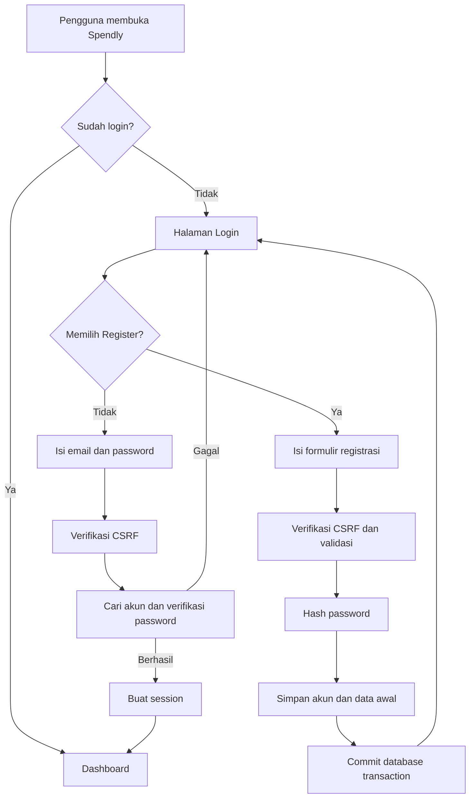

# Penjelasan Kode Spendly

Dokumen ini membantu memahami bagaimana kode Spendly bekerja. Penjelasan dibuat berdasarkan kelompok kode dan alur program, bukan menerjemahkan setiap baris yang tidak memiliki fungsi khusus. Dengan begitu, bagian penting tetap dijelaskan tanpa membuat dokumentasi sulit dibaca.

Dokumen ini akan dikembangkan secara bertahap. Bagian pertama membahas fondasi aplikasi: koneksi database, fungsi umum, dan perlindungan CSRF.

---

## Daftar Bagian

| Bagian | File | Fungsi |
|---|---|---|
| 1. Fondasi aplikasi | `includes/db.php` | Menghubungkan PHP dengan database |
| 1. Fondasi aplikasi | `includes/functions.php` | Menyediakan fungsi umum |
| 1. Fondasi aplikasi | `includes/csrf.php` | Membuat dan memeriksa token CSRF |
| 2. Autentikasi | `includes/auth.php`, `login.php`, `register.php`, `logout.php` | Mengelola akun dan session |
| 3. Transaksi | File transaksi dan `includes/transactions.php` | Mengelola catatan keuangan |
| 4. Anggaran | File anggaran dan `includes/budgets.php` | Mengelola batas pengeluaran |
| 5. Kategori dan metode pembayaran | File terkait dan `includes/catalog.php` | Mengelola data kategori dan metode pembayaran |
| 6. Dashboard dan laporan | `dashboard.php`, `reports.php`, `includes/reports.php` | Menghitung dan menampilkan ringkasan |
| 7. Antarmuka | Header, footer, CSS, dan JavaScript | Mengatur tampilan dan interaksi |

Bagian selanjutnya akan ditambahkan dengan pola penjelasan yang sama.

---

# Bagian 1 — Fondasi Aplikasi

## 1.1 Koneksi Database — `includes/db.php`

### Tujuan file

File ini bertanggung jawab membuat koneksi antara aplikasi PHP dan database MySQL/MariaDB menggunakan PDO.

File ini menyediakan satu fungsi utama:

`get_db_connection(): PDO`

Fungsi tersebut dipanggil oleh halaman atau helper lain ketika membutuhkan akses database.

### A. Fungsi dan koneksi yang digunakan ulang

Kode:

```php
function get_db_connection(): PDO
{
    static $pdo = null;

    if ($pdo !== null) {
        return $pdo;
    }
```

Penjelasan:

- `function get_db_connection(): PDO` mendefinisikan fungsi dengan nama `get_db_connection`. Tanda `: PDO` menunjukkan bahwa fungsi ini diharapkan mengembalikan objek PDO.
- `static $pdo = null` membuat variabel lokal yang nilainya tetap tersedia di antara pemanggilan fungsi selama satu request PHP berlangsung.
- Pada pemanggilan pertama, nilainya masih `null`, sehingga fungsi akan membuat koneksi.
- Pada pemanggilan berikutnya, jika koneksi sudah tersedia, objek yang sama langsung dikembalikan.

Tujuannya adalah menghindari pembuatan koneksi database berulang kali dalam satu request.

### B. Menentukan lokasi file konfigurasi

Kode:

```php
$configFile = __DIR__ . '/../config/database.php';

if (!file_exists($configFile)) {
    http_response_code(500);
    // Halaman pemberitahuan konfigurasi ditampilkan di sini.
    exit;
}
```

Penjelasan:

- `__DIR__` adalah konstanta PHP yang berisi lokasi direktori file saat ini, yaitu folder `includes`.
- `../config/database.php` berarti naik satu direktori, lalu masuk ke folder `config`.
- `file_exists()` memeriksa apakah file konfigurasi tersedia.
- `http_response_code(500)` memberi tahu browser bahwa terjadi kesalahan pada sisi server.
- Jika file tidak ditemukan, aplikasi menampilkan petunjuk untuk membuat file konfigurasi, kemudian `exit` menghentikan proses.

File `config/database.php` tidak disimpan di GitHub karena berisi kredensial lokal. Pengguna perlu membuatnya sendiri dengan menyalin `config/database.example.php`.

### C. Membaca konfigurasi

Kode:

```php
$config = require $configFile;

$host    = $config['host'] ?? '127.0.0.1';
$port    = $config['port'] ?? 3306;
$dbname  = $config['dbname'] ?? 'spendly_db';
$charset = $config['charset'] ?? 'utf8mb4';
$user    = $config['username'] ?? 'root';
$pass    = $config['password'] ?? '';
```

Penjelasan:

- `require` menjalankan file konfigurasi dan mengambil nilai yang dikembalikan oleh `return [ ... ]`.
- File konfigurasi mengembalikan array yang berisi host, port, nama database, username, password, dan charset.
- Operator `??` disebut *null coalescing operator*. Operator ini menggunakan nilai di sebelah kiri jika tersedia dan tidak bernilai `null`; jika tidak, nilai default di sebelah kanan digunakan.

Contohnya, jika `host` tidak ditulis di konfigurasi, aplikasi menggunakan `127.0.0.1`.

### D. Membuat DSN dan opsi PDO

Kode:

```php
$dsn = "mysql:host={$host};port={$port};dbname={$dbname};charset={$charset}";

$options = [
    PDO::ATTR_ERRMODE            => PDO::ERRMODE_EXCEPTION,
    PDO::ATTR_DEFAULT_FETCH_MODE => PDO::FETCH_ASSOC,
    PDO::ATTR_EMULATE_PREPARES   => false,
];
```

Penjelasan:

- **DSN (Data Source Name)** adalah string yang memberi tahu PDO jenis database dan alamat koneksi yang akan digunakan.
- `mysql:` menunjukkan driver MySQL.
- `host`, `port`, `dbname`, dan `charset` diisi dari file konfigurasi.

Tiga opsi PDO memiliki fungsi berikut:

| Opsi | Fungsi |
|---|---|
| `PDO::ATTR_ERRMODE => PDO::ERRMODE_EXCEPTION` | Membuat PDO melempar exception ketika terjadi kesalahan database |
| `PDO::ATTR_DEFAULT_FETCH_MODE => PDO::FETCH_ASSOC` | Mengambil hasil query sebagai array asosiatif dengan nama kolom sebagai key |
| `PDO::ATTR_EMULATE_PREPARES => false` | Meminta PDO menggunakan prepared statement native jika didukung driver |

Pengaturan tersebut membuat penanganan error lebih jelas dan membantu penggunaan prepared statement secara konsisten.

### E. Membuka koneksi dan menangani kesalahan

Kode:

```php
try {
    $pdo = new PDO($dsn, $user, $pass, $options);
} catch (PDOException $e) {
    error_log('Database connection error: ' . $e->getMessage());

    http_response_code(500);
    // Halaman pesan kesalahan ditampilkan di sini.
    exit;
}

return $pdo;
```

Penjelasan:

- `try` menjalankan proses yang berpotensi menghasilkan exception.
- `new PDO(...)` mencoba membuat koneksi berdasarkan DSN, username, password, dan opsi.
- Jika gagal, PHP masuk ke bagian `catch`.
- `error_log()` menulis detail error ke log server untuk membantu proses pemeriksaan.
- Pengguna hanya melihat halaman error umum, bukan detail koneksi atau kredensial.
- `exit` menghentikan proses jika koneksi gagal.
- Jika berhasil, `return $pdo` mengembalikan objek koneksi kepada pemanggil.

### Alur singkat file ini

```text
Halaman membutuhkan database
          |
          v
get_db_connection()
          |
          v
Apakah koneksi sudah tersedia?
       /       \\
     Ya         Tidak
     |            |
Kembalikan     Baca database.php
koneksi        |
yang ada       v
            Buat koneksi PDO
               |
          /         \\
       Berhasil      Gagal
          |            |
       Return       Tampilkan error
       PDO          dan hentikan proses
```

### Contoh penggunaan

Halaman PHP dapat menggunakan koneksi ini setelah memuat file helper:

```php
require_once __DIR__ . '/includes/db.php';

$pdo = get_db_connection();
```

Variabel `$pdo` kemudian dapat digunakan untuk menjalankan query, misalnya `$pdo->prepare(...)`.

---

## 1.2 Fungsi Umum — `includes/functions.php`

### Tujuan file

File ini berisi fungsi-fungsi kecil yang digunakan di banyak bagian aplikasi. Dengan mengumpulkan fungsi tersebut di satu tempat, halaman lain tidak perlu menulis ulang proses yang sama.

### A. Memulai session — `safe_session_start()`

Kode inti:

```php
function safe_session_start(): void
{
    if (session_status() === PHP_SESSION_ACTIVE) {
        return;
    }

    $isSecure = (!empty($_SERVER['HTTPS']) && $_SERVER['HTTPS'] !== 'off')
        || (isset($_SERVER['SERVER_PORT']) && (int) $_SERVER['SERVER_PORT'] === 443);

    session_set_cookie_params([
        'lifetime' => 0,
        'path'     => '/',
        'domain'   => '',
        'secure'   => $isSecure,
        'httponly' => true,
        'samesite' => 'Lax',
    ]);

    session_start();
}
```

Penjelasan:

1. `session_status()` memeriksa status session PHP.
2. Jika session sudah aktif, `return` menghentikan fungsi. Ini mencegah pemanggilan `session_start()` berulang.
3. Variabel `$isSecure` memeriksa apakah request menggunakan HTTPS.
4. `session_set_cookie_params()` mengatur atribut cookie session sebelum session dimulai.
5. `session_start()` memulai session atau melanjutkan session yang sudah ada.

Arti pengaturan cookie:

| Pengaturan | Arti |
|---|---|
| `lifetime => 0` | Cookie berakhir ketika browser ditutup |
| `path => '/'` | Cookie dapat digunakan pada seluruh path di host tersebut |
| `domain => ''` | Menggunakan host saat ini |
| `secure => $isSecure` | Cookie hanya dikirim melalui HTTPS ketika HTTPS digunakan |
| `httponly => true` | JavaScript tidak dapat membaca cookie session |
| `samesite => 'Lax'` | Membantu membatasi pengiriman cookie pada sebagian navigasi lintas situs |

Fungsi ini penting karena informasi login disimpan di dalam session. File autentikasi dan CSRF menggunakan fungsi yang sama agar pengaturan session tetap konsisten.

### B. Mengamankan output HTML — `e()`

Kode:

```php
function e($value): string
{
    return htmlspecialchars((string) ($value ?? ''), ENT_QUOTES, 'UTF-8');
}
```

Penjelasan:

- Nilai `null` diganti dengan string kosong.
- Nilai kemudian dikonversi menjadi string.
- `htmlspecialchars()` mengubah karakter khusus HTML menjadi bentuk aman untuk ditampilkan sebagai teks.
- `ENT_QUOTES` membuat tanda kutip tunggal dan ganda ikut di-escape.
- `UTF-8` menentukan encoding karakter.

Contoh penggunaan:

```php
<p><?= e($user['full_name']) ?></p>
```

Nama pengguna ditampilkan sebagai teks, bukan diperlakukan sebagai markup HTML. Helper ini membantu mengurangi risiko Cross-Site Scripting (XSS).

Gunakan helper ini saat menampilkan nilai yang berasal dari pengguna atau sumber data yang tidak boleh dianggap sebagai HTML tepercaya.

### C. Format mata uang — `format_currency()`

Kode:

```php
function format_currency($amount): string
{
    $num = (float) ($amount ?? 0);
    return 'Rp ' . number_format($num, 0, ',', '.');
}
```

Penjelasan:

- Jika nilai kosong atau `null`, aplikasi menggunakan angka nol.
- Nilai dikonversi menjadi tipe `float`.
- `number_format()` mengatur format angka dengan nol angka desimal, koma sebagai pemisah desimal, dan titik sebagai pemisah ribuan.
- Hasil akhirnya diberi awalan `Rp`.

Contoh:

```php
format_currency(150000); // Rp 150.000
```

Fungsi ini hanya mengatur tampilan. Fungsi ini tidak menghitung saldo atau mengubah nilai yang disimpan di database.

### D. Format tanggal — `format_date()`

Kode inti:

```php
function format_date(?string $dateString, string $format = 'd M Y'): string
{
    if (empty($dateString)) {
        return '-';
    }

    $timestamp = strtotime($dateString);
    if ($timestamp === false) {
        return (string) $dateString;
    }

    return date($format, $timestamp);
}
```

Penjelasan:

- Parameter `?string` berarti nilai yang diterima dapat berupa string atau `null`.
- Jika tanggal kosong, fungsi mengembalikan tanda `-`.
- `strtotime()` mencoba membaca string tanggal dan mengubahnya menjadi timestamp.
- Jika gagal, fungsi mengembalikan nilai awal agar informasi tidak hilang.
- Jika berhasil, `date()` memformat tanggal sesuai format yang diminta.

Format default `d M Y` akan menampilkan tanggal seperti `01 Nov 2026`.

### E. Redirect — `redirect()`

Kode:

```php
function redirect(string $url): void
{
    header('Location: ' . $url);
    exit;
}
```

Penjelasan:

- `header('Location: ...')` mengirim header HTTP agar browser membuka URL tujuan.
- `exit` menghentikan proses PHP setelah redirect dikirim.

`exit` penting agar kode halaman berikutnya tidak terus dijalankan setelah pengguna diarahkan ke halaman lain.

### F. Flash message

Dua fungsi yang digunakan adalah `set_flash_message()` dan `get_flash_messages()`.

Kode penyimpanan:

```php
function set_flash_message(string $type, string $message): void
{
    safe_session_start();

    $_SESSION['flash_messages'][] = [
        'type'    => $type,
        'message' => $message,
    ];
}
```

Kode pengambilan:

```php
function get_flash_messages(): array
{
    safe_session_start();

    $messages = $_SESSION['flash_messages'] ?? [];
    unset($_SESSION['flash_messages']);

    return $messages;
}
```

Penjelasan:

- Flash message adalah pesan sementara yang disimpan dalam session.
- `set_flash_message()` menambahkan pesan ke array `$_SESSION['flash_messages']`.
- `get_flash_messages()` mengambil seluruh pesan yang tersimpan.
- `unset()` menghapus pesan setelah diambil agar pesan tidak muncul kembali pada request berikutnya.

Contoh alur: pengguna menyimpan transaksi, aplikasi menyimpan pesan sukses, lalu melakukan redirect ke daftar transaksi. Halaman tujuan membaca dan menampilkan pesan tersebut satu kali.

### G. Membuat URL aplikasi — `base_url()`

Kode inti:

```php
function base_url(string $path = ''): string
{
    $scriptName = $_SERVER['SCRIPT_NAME'] ?? '';
    $dirName = rtrim(str_replace('\\', '/', dirname($scriptName)), '/');

    if ($dirName === '' || $dirName === '.') {
        $base = '';
    } else {
        $base = $dirName;
    }

    $cleanPath = ltrim($path, '/');

    if ($cleanPath === '') {
        return $base === '' ? '/' : $base . '/';
    }

    return ($base === '' ? '' : $base) . '/' . $cleanPath;
}
```

Penjelasan:

- `$_SERVER['SCRIPT_NAME']` berisi path script PHP yang sedang dijalankan.
- `dirname()` mengambil direktori dari path tersebut.
- `str_replace()` menyeragamkan pemisah direktori menjadi garis miring.
- `rtrim()` menghapus garis miring di akhir path.
- Jika aplikasi berada di root, nilai dasar URL menjadi string kosong.
- Jika aplikasi berada di subfolder seperti `/spendly`, path tersebut digunakan sebagai dasar.
- `ltrim()` menghapus garis miring di awal path yang diberikan agar URL tidak memiliki pemisah ganda.

Contoh hasil pada instalasi XAMPP:

```php
base_url('login.php'); // /spendly/login.php
base_url('assets/css/app.css'); // /spendly/assets/css/app.css
```

Fungsi ini membantu aplikasi tetap menggunakan URL yang sesuai ketika dijalankan dari subfolder.

---

## 1.3 Perlindungan CSRF — `includes/csrf.php`

### Tujuan file

CSRF adalah singkatan dari *Cross-Site Request Forgery*. Serangan ini mencoba membuat browser pengguna yang sedang login mengirim request tanpa sepengetahuan atau persetujuan pengguna.

Spendly menggunakan token CSRF yang disimpan di session. Formulir mengirim token tersebut bersama data lainnya. Saat formulir diproses, server membandingkan token yang dikirim dengan token di session.

File ini memiliki tiga fungsi utama:

- `get_csrf_token()`
- `csrf_field()`
- `verify_csrf_token()`

### A. Membuat token — `get_csrf_token()`

Kode:

```php
function get_csrf_token(): string
{
    safe_session_start();

    if (empty($_SESSION['csrf_token'])) {
        $_SESSION['csrf_token'] = bin2hex(random_bytes(32));
    }

    return $_SESSION['csrf_token'];
}
```

Penjelasan:

1. Memastikan session sudah dimulai melalui `safe_session_start()`.
2. Memeriksa apakah session sudah memiliki `csrf_token`.
3. Jika belum ada, `random_bytes(32)` menghasilkan 32 byte acak yang aman secara kriptografis.
4. `bin2hex()` mengubah byte tersebut menjadi string heksadesimal.
5. Token disimpan di session dan dikembalikan oleh fungsi.

Token disimpan dalam session supaya server dapat membandingkannya dengan nilai yang dikirim formulir.

### B. Menyisipkan token ke formulir — `csrf_field()`

Kode:

```php
function csrf_field(): string
{
    $token = htmlspecialchars(get_csrf_token(), ENT_QUOTES, 'UTF-8');

    return '<input type="hidden" name="csrf_token" value="' . $token . '">';
}
```

Penjelasan:

- Fungsi mengambil token dari `get_csrf_token()`.
- Token di-escape untuk memastikan nilainya aman ketika dimasukkan ke atribut HTML.
- Fungsi mengembalikan input tersembunyi dengan nama `csrf_token`.
- Karena input bertipe `hidden`, token tidak terlihat sebagai kolom formulir biasa, tetapi tetap ikut dikirim ketika formulir disubmit.

Contoh pemakaian pada formulir:

```php
<form method="POST" action="transaction-create.php">
    <?= csrf_field() ?>

    <!-- Field transaksi lainnya -->

    <button type="submit">Save</button>
</form>
```

### C. Memeriksa token — `verify_csrf_token()`

Kode:

```php
function verify_csrf_token(?string $token): bool
{
    safe_session_start();

    if (empty($token) || empty($_SESSION['csrf_token'])) {
        return false;
    }

    return hash_equals($_SESSION['csrf_token'], $token);
}
```

Penjelasan:

- Parameter `?string $token` menerima string atau `null`.
- Session dipastikan aktif.
- Jika token dari formulir kosong atau token di session tidak tersedia, fungsi mengembalikan `false`.
- `hash_equals()` membandingkan token dengan cara yang dirancang untuk mengurangi risiko timing attack.
- Jika kedua token cocok, fungsi mengembalikan `true`; jika tidak cocok, hasilnya `false`.

Contoh penggunaan saat memproses formulir:

```php
if (!verify_csrf_token($_POST['csrf_token'] ?? null)) {
    $errors['general'] = 'Security verification failed.';
} else {
    // Validasi dan proses data formulir.
}
```

Pemeriksaan ini harus dilakukan oleh handler pada setiap operasi yang mengubah data. Memasukkan token ke formulir saja belum cukup jika halaman tujuan tidak memverifikasinya.

### D. Hubungan ketiga fungsi

```text
Halaman menampilkan formulir
          |
          v
csrf_field()
          |
          v
get_csrf_token()
          |
          v
Token disimpan di session
dan dimasukkan ke hidden input
          |
          v
Pengguna mengirim formulir
          |
          v
verify_csrf_token()
          |
     /         \\
  Cocok       Tidak cocok
    |              |
Proses data     Tolak proses
```

### Catatan implementasi

Pemeriksaan token hanya efektif jika setiap handler yang mengubah data benar-benar memanggil `verify_csrf_token()`.

Pada kode Spendly saat ini, handler `logout.php` belum memvalidasi token tersebut. Temuan ini juga dicatat dalam Dokumentasi Teknis. Jadi, keberadaan helper CSRF tidak otomatis berarti semua endpoint sudah terlindungi.

---

## 1.4 Hubungan Antarfile Fondasi

Ketiga file memiliki tanggung jawab yang berbeda:

| File | Menjawab pertanyaan |
|---|---|
| `db.php` | Bagaimana PHP terhubung ke MySQL? |
| `functions.php` | Fungsi umum apa yang dibutuhkan oleh banyak halaman? |
| `csrf.php` | Bagaimana formulir membuktikan bahwa request berasal dari halaman aplikasi? |

Hubungan sederhananya:

- Halaman fitur memuat helper yang diperlukan.
- `db.php` menyediakan koneksi ketika data database dibutuhkan.
- `functions.php` menyediakan session dan fungsi umum.
- `csrf.php` menggunakan session dari `functions.php` untuk menyimpan dan memeriksa token.

**Catatan urutan pemuatan:** `auth.php` memuat `functions.php` terlebih dahulu, kemudian `csrf.php`. Karena `csrf.php` memanggil `safe_session_start()`, fungsi tersebut harus sudah tersedia sebelum helper CSRF dijalankan.

---

## Ringkasan Bagian 1

Setelah memahami bagian ini, pembaca seharusnya mengetahui:

- Bagaimana Spendly membuat koneksi ke MySQL menggunakan PDO.
- Mengapa koneksi database digunakan kembali selama satu request.
- Bagaimana session dimulai dan cookie session dikonfigurasi.
- Bagaimana HTML output, tanggal, mata uang, redirect, dan flash message ditangani.
- Bagaimana token CSRF dibuat, disisipkan ke formulir, dan diverifikasi.
- Mengapa helper bersama digunakan oleh banyak halaman.

**Bagian berikutnya:** autentikasi pengguna — `includes/auth.php`, `login.php`, `register.php`, dan `logout.php`.


# Bagian 2 — Autentikasi Pengguna

Bagian ini membahas bagaimana Spendly mendaftarkan pengguna, memeriksa data login, mempertahankan session, melindungi halaman, dan mengakhiri session.

File yang dibahas:

- `includes/auth.php`
- `register.php`
- `login.php`
- `logout.php`

## 2.1 File Helper Autentikasi — `includes/auth.php`

### Tujuan file

File ini berisi fungsi utama untuk mengelola akun dan status login. Halaman lain memanggil fungsi-fungsi dari file ini agar proses autentikasi tidak ditulis berulang kali.

Di bagian awal, file memuat helper session dan CSRF:

```php
require_once __DIR__ . '/functions.php';
require_once __DIR__ . '/csrf.php';
```

`require_once` memuat file yang disebutkan satu kali. `functions.php` dimuat terlebih dahulu karena fungsi session seperti `safe_session_start()` diperlukan oleh helper autentikasi dan CSRF.

### A. Memeriksa status login — `is_logged_in()`

Kode:

```php
function is_logged_in(): bool
{
    start_session_safe();
    return !empty($_SESSION['user_id']);
}
```

Penjelasan:

- `start_session_safe()` memastikan session sudah aktif.
- `$_SESSION['user_id']` berisi ID pengguna setelah login berhasil.
- `empty()` memeriksa apakah nilai tersebut kosong.
- Fungsi mengembalikan `true` jika pengguna memiliki ID di session, dan `false` jika tidak.

Dengan kata lain, aplikasi menggunakan keberadaan `user_id` dalam session sebagai penanda bahwa pengguna sudah masuk.

### B. Mengambil data pengguna — `current_user()`

Kode:

```php
function current_user(): ?array
{
    start_session_safe();
    return $_SESSION['user'] ?? null;
}
```

Data pengguna yang disimpan di session berupa array sederhana, berisi ID, nama lengkap, dan email.

Tanda `?array` berarti fungsi dapat mengembalikan array atau `null`. Jika data pengguna belum tersedia, operator `??` mengembalikan `null`.

### C. Melindungi halaman — `require_login()`

Kode:

```php
function require_login(): void
{
    if (!is_logged_in()) {
        set_flash_message('warning', 'Please sign in to access that page.');
        redirect(base_url('login.php'));
    }
}
```

Penjelasan:

1. Fungsi memanggil `is_logged_in()`.
2. Jika hasilnya `false`, pengguna belum login.
3. Aplikasi menyimpan pesan peringatan melalui `set_flash_message()`.
4. Pengguna diarahkan ke halaman login melalui `redirect()`.

Halaman privat seperti Dashboard, Transactions, Budgets, Categories, dan Reports memanggil fungsi ini sebelum mengambil data pengguna.

### D. Membatasi halaman guest — `require_guest()`

Kode:

```php
function require_guest(): void
{
    if (is_logged_in()) {
        redirect(base_url('dashboard.php'));
    }
}
```

Fungsi ini digunakan pada halaman seperti Login dan Register. Jika pengguna sudah login, ia diarahkan ke Dashboard. Jadi, pengguna yang sudah masuk tidak perlu kembali ke halaman login atau registrasi.

### E. Membuat data awal pengguna — `seed_default_user_data()`

Saat akun baru dibuat, Spendly otomatis menyiapkan kategori dan metode pembayaran awal.

Fungsi ini menerima dua parameter:

- `$pdo`: koneksi database.
- `$userId`: ID pengguna yang baru dibuat.

Kategori dan metode pembayaran dimasukkan menggunakan prepared statement:

```php
$catStmt = $pdo->prepare('
    INSERT INTO categories (user_id, name, type, color, created_at)
    VALUES (:user_id, :name, :type, :color, NOW())
');

foreach ($defaultCategories as $cat) {
    $catStmt->execute([
        ':user_id' => $userId,
        ':name'    => $cat['name'],
        ':type'    => $cat['type'],
        ':color'   => $cat['color'],
    ]);
}
```

Penjelasan:

- `prepare()` menyiapkan query dengan parameter bernama.
- `foreach` mengulang setiap kategori pada array `$defaultCategories`.
- `execute()` menjalankan query dengan nilai kategori yang sedang diproses.
- `$userId` memastikan kategori tersebut tercatat sebagai milik pengguna yang baru mendaftar.

Pola serupa digunakan untuk memasukkan empat metode pembayaran bawaan.

### F. Registrasi pengguna — `register_user()`

Fungsi ini menjalankan proses registrasi dari awal sampai penyimpanan akun.

#### 1. Mengambil input

```php
$fullName = trim((string) ($data['full_name'] ?? ''));
$email = trim((string) ($data['email'] ?? ''));
$password = (string) ($data['password'] ?? '');
$passwordConfirm = (string) ($data['password_confirmation'] ?? '');
```

Nilai diambil dari array input. `trim()` menghapus spasi di awal dan akhir nama serta email. Password tidak di-`trim`, sehingga spasi yang dimasukkan pengguna tetap dianggap bagian dari password.

#### 2. Memvalidasi input

Fungsi memeriksa:

- Nama tidak boleh kosong dan maksimal 100 karakter.
- Email tidak boleh kosong, harus memiliki format email valid, dan maksimal 190 karakter.
- Password wajib diisi dan minimal delapan karakter.
- Password dan konfirmasi password harus sama.

Contoh pemeriksaan email:

```php
if ($email === '') {
    $errors['email'] = 'Email address is required.';
} elseif (!filter_var($email, FILTER_VALIDATE_EMAIL)) {
    $errors['email'] = 'Please enter a valid email address.';
}
```

`filter_var()` dengan `FILTER_VALIDATE_EMAIL` memeriksa format alamat email. Jika data tidak valid, pesan dimasukkan ke array `$errors`.

#### 3. Memeriksa email yang sudah digunakan

```php
$checkStmt = $pdo->prepare(
    'SELECT id FROM users WHERE email = :email LIMIT 1'
);
$checkStmt->execute([':email' => $email]);

if ($checkStmt->fetch()) {
    $errors['email'] = 'An account with this email address already exists.';
}
```

Aplikasi mencari akun dengan email yang sama. Jika query menemukan baris, email dianggap sudah digunakan.

Database juga memiliki unique constraint pada kolom email. Constraint tersebut menjadi perlindungan tambahan agar email tetap unik meskipun ada dua request yang mencoba mendaftarkan alamat sama pada waktu hampir bersamaan.

#### 4. Membuat password hash

```php
$passwordHash = password_hash($password, PASSWORD_DEFAULT);
```

Password asli diubah menjadi hash menggunakan mekanisme bawaan PHP. Nilai hash inilah yang disimpan ke database, bukan password dalam bentuk teks biasa.

Nantinya, saat login, aplikasi menggunakan `password_verify()` untuk memeriksa password yang dimasukkan.

#### 5. Menyimpan akun dan data awal secara bersamaan

```php
$pdo->beginTransaction();

// Insert user dan ambil ID yang baru dibuat.
$userId = (int) $pdo->lastInsertId();

// Buat kategori serta metode pembayaran awal.
seed_default_user_data($pdo, $userId);

$pdo->commit();
```

Proses tersebut menggunakan database transaction.

- `beginTransaction()` memulai transaksi database.
- Akun pengguna dimasukkan ke tabel `users`.
- `lastInsertId()` mengambil ID akun yang baru dibuat.
- `seed_default_user_data()` membuat kategori dan metode pembayaran untuk akun tersebut.
- `commit()` mengesahkan seluruh perubahan.

Jika terjadi error, blok `catch` memeriksa apakah transaksi masih aktif, lalu menjalankan `rollBack()`. Dengan demikian, aplikasi tidak meninggalkan akun yang baru dibuat tanpa data awal ketika proses seeding gagal.

## 2.2 Halaman Registrasi — `register.php`

### Tujuan file

File ini menjadi penghubung antara formulir registrasi di browser dan fungsi `register_user()` di `auth.php`.

Pada awal file, beberapa helper dimuat dan akses guest diperiksa:

```php
require_once __DIR__ . '/includes/auth.php';
require_once __DIR__ . '/includes/db.php';
require_once __DIR__ . '/includes/csrf.php';
require_once __DIR__ . '/includes/functions.php';

require_guest();
```

Jika pengguna sudah login, `require_guest()` akan mengarahkannya ke Dashboard.

### Alur saat formulir dikirim

```php
if ($_SERVER['REQUEST_METHOD'] === 'POST') {
    $submittedToken = $_POST['csrf_token'] ?? '';

    if (!verify_csrf_token($submittedToken)) {
        $errors['general'] = 'Security session expired. Please refresh the page and try again.';
    } else {
        $fullName = trim((string) ($_POST['full_name'] ?? ''));
        $email = trim((string) ($_POST['email'] ?? ''));

        $pdo = get_db_connection();
        $result = register_user($pdo, $_POST);
    }
}
```

Penjelasan:

1. `$_SERVER['REQUEST_METHOD']` menunjukkan metode request. Proses registrasi dijalankan ketika metode tersebut adalah POST.
2. Data formulir dikirim melalui array `$_POST`.
3. Token CSRF diperiksa terlebih dahulu.
4. Jika token valid, halaman membuka koneksi database.
5. `register_user()` melakukan validasi dan menyimpan akun.

Jika registrasi berhasil, halaman menyimpan flash message dan mengarahkan pengguna ke Login. Jika gagal, pesan kesalahan dikembalikan untuk ditampilkan di formulir.

Bagian HTML di bawah proses PHP membuat kolom nama lengkap, email, password, dan konfirmasi password. Nilai yang ditampilkan kembali menggunakan helper `e()` agar output tetap di-escape.

## 2.3 Halaman Login — `login.php`

### Tujuan file

File ini menampilkan formulir login dan meneruskan data yang dikirim pengguna ke fungsi `login_user()`.

Seperti halaman registrasi, Login hanya ditujukan untuk guest:

```php
require_guest();
```

### Alur login

Kode inti:

```php
if ($_SERVER['REQUEST_METHOD'] === 'POST') {
    $submittedToken = $_POST['csrf_token'] ?? '';

    if (!verify_csrf_token($submittedToken)) {
        $error = 'Security session expired. Please refresh and try again.';
    } else {
        $email = trim((string) ($_POST['email'] ?? ''));
        $password = (string) ($_POST['password'] ?? '');

        $pdo = get_db_connection();
        $result = login_user($pdo, $email, $password);

        if ($result['success']) {
            set_flash_message('success', 'Welcome back to Spendly!');
            redirect(base_url('dashboard.php'));
        } else {
            $error = $result['error'];
        }
    }
}
```

Urutannya:

1. Memastikan request menggunakan POST.
2. Memeriksa token CSRF.
3. Mengambil email dan password dari formulir.
4. Membuat koneksi database.
5. Memanggil `login_user()`.
6. Jika berhasil, menyimpan pesan sukses dan mengarahkan pengguna ke Dashboard.
7. Jika gagal, menyimpan pesan error untuk ditampilkan pada halaman.

### Memeriksa kredensial — `login_user()`

Di dalam `auth.php`, query mencari akun berdasarkan email:

```php
$stmt = $pdo->prepare('
    SELECT id, full_name, email, password_hash
    FROM users
    WHERE email = :email
    LIMIT 1
');

$stmt->execute([':email' => $email]);
$user = $stmt->fetch();
```

- `prepare()` menyiapkan query dengan parameter `:email`.
- `execute()` mengirim nilai email sebagai parameter.
- `fetch()` mengambil satu hasil. Jika tidak ada akun yang cocok, hasilnya bernilai false.

Selanjutnya password diperiksa:

```php
if (!$user || !password_verify($password, $user['password_hash'])) {
    return ['success' => false, 'error' => 'Invalid email or password.'];
}
```

Kondisi tersebut menangani dua kemungkinan: akun tidak ditemukan atau password tidak cocok.

Pesan error dibuat sama untuk kedua kondisi agar halaman tidak memberi petunjuk apakah alamat email tertentu telah terdaftar.

### Membuat session setelah login berhasil

```php
start_session_safe();
session_regenerate_id(true);

$_SESSION['user_id'] = (int) $user['id'];
$_SESSION['user'] = [
    'id'        => (int) $user['id'],
    'full_name' => $user['full_name'],
    'email'     => $user['email'],
];
```

Penjelasan:

- Session dipastikan aktif.
- `session_regenerate_id(true)` membuat ID session baru dan menghapus session ID lama. Ini membantu mencegah session fixation.
- ID pengguna disimpan di `$_SESSION['user_id']`.
- Informasi dasar pengguna disimpan di `$_SESSION['user']`.

Setelah bagian ini berhasil, `is_logged_in()` dapat mengenali pengguna sebagai pengguna yang sudah masuk.

## 2.4 Logout — `logout.php`

### Tujuan file

File ini memanggil `logout_user()` untuk mengakhiri session pengguna, kemudian mengarahkan browser ke halaman login.

Fungsi inti di `auth.php`:

```php
function logout_user(): void
{
    start_session_safe();

    $_SESSION = [];

    if (ini_get('session.use_cookies')) {
        $params = session_get_cookie_params();

        setcookie(
            session_name(),
            '',
            time() - 42000,
            $params['path'],
            $params['domain'],
            $params['secure'],
            $params['httponly']
        );
    }

    session_destroy();
}
```

Penjelasan:

1. Memastikan session aktif.
2. Mengosongkan seluruh data pada `$_SESSION`.
3. Memeriksa apakah session menggunakan cookie.
4. Jika menggunakan cookie, `setcookie()` mengirim cookie dengan waktu kedaluwarsa di masa lalu. Ini meminta browser menghapus cookie session.
5. `session_destroy()` menghapus data session di server.

Setelah itu, `logout.php` membuat flash message bahwa pengguna sudah keluar dan melakukan redirect ke halaman login.

### Catatan keamanan pada implementasi saat ini

Kode `logout.php` memeriksa apakah request menggunakan POST, tetapi tidak benar-benar menjalankan `verify_csrf_token()`. Komentar di file tersebut menyatakan logout tetap dilakukan meskipun pemeriksaan gagal, dan fungsi `logout_user()` dipanggil tanpa syarat.

Artinya, logout saat ini belum menerapkan pembatasan POST-only dan validasi CSRF secara efektif. Hal ini sudah dicatat dalam Dokumentasi Teknis. Penjelasan ini menggambarkan kode yang ada, bukan menyatakan bahwa implementasinya sudah ideal.

## 2.5 Alur Lengkap Autentikasi



## Ringkasan Bagian 2

Setelah memahami bagian ini, pembaca seharusnya mengetahui:

- Bagaimana Spendly membedakan pengguna yang sudah login dan guest.
- Bagaimana halaman privat dilindungi oleh `require_login()`.
- Bagaimana registrasi memvalidasi input dan menyimpan password dalam bentuk hash.
- Mengapa pembuatan akun dan data awal menggunakan database transaction.
- Bagaimana login memeriksa password dan membuat session baru.
- Bagaimana logout menghapus session dan cookie.
- Bagian mana dari handler logout yang masih perlu diperbaiki.

**Bagian berikutnya:** pengelolaan transaksi — `includes/transactions.php`, `transactions.php`, `transaction-create.php`, `transaction-edit.php`, dan `transaction-delete.php`.
