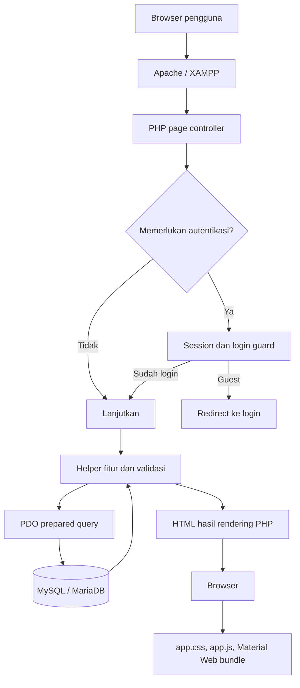
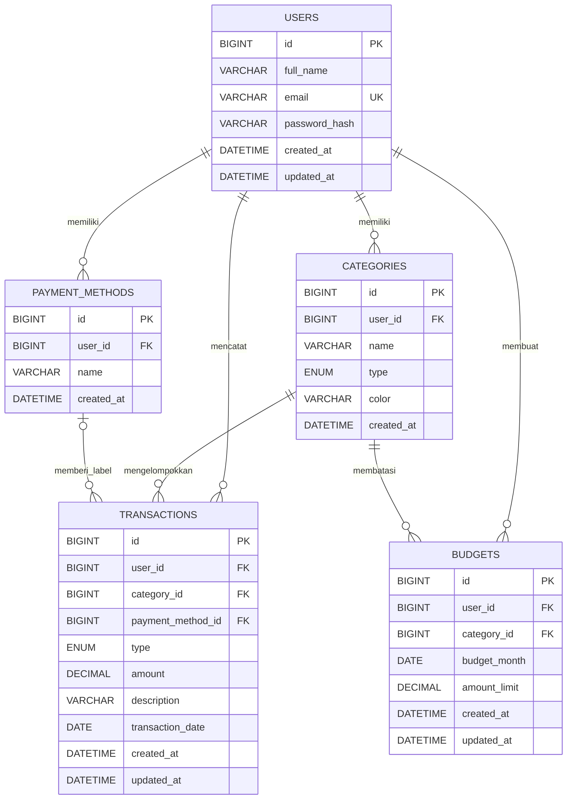

# Dokumentasi Teknis Spendly

> **Proyek:** Spendly — Personal Expense Tracker  
> **Slogan:** *Track your spending. Stay in control.*  
> **Repositori:** [mayangzahratusita08/spendly](https://github.com/mayangzahratusita08/spendly)  
> **Acuan dokumentasi:** branch `main`, commit `92faf2c8b513077357a37a3bf874ecc9e04d4f7f`

Dokumen ini menjelaskan implementasi Spendly saat ini: tujuan aplikasi, teknologi yang digunakan, susunan kode dan database, cara kerja fitur utama, serta cara memasang, membangun, menjalankan, dan memelihara aplikasi secara lokal.

Penjelasan di bawah disusun berdasarkan file yang tersedia di repositori. Isinya menggambarkan aplikasi yang benar-benar telah diimplementasikan, bukan fitur yang baru sebatas rencana atau eksplorasi pada branch yang belum digabungkan.

---

## 1. Gambaran Umum Proyek

Spendly adalah aplikasi keuangan pribadi berbasis web untuk mencatat pemasukan dan pengeluaran, mengelompokkan transaksi, menetapkan batas pengeluaran bulanan, serta meninjau aktivitas keuangan.

Aplikasi ini dirancang untuk penggunaan akun individual. Setiap pengguna yang terdaftar memiliki data transaksi, kategori, metode pembayaran, dan anggarannya sendiri. Mata uang awal yang digunakan adalah Rupiah Indonesia (IDR), sedangkan bahasa antarmuka aplikasi adalah bahasa Inggris.

### 1.1 Tujuan utama

- Mencatat pemasukan dan pengeluaran pribadi.
- Mengelompokkan catatan keuangan berdasarkan kategori dan metode pembayaran.
- Meninjau serta memfilter riwayat transaksi.
- Menetapkan anggaran bulanan untuk kategori pengeluaran.
- Membandingkan pengeluaran aktual dengan batas anggaran.
- Meninjau ringkasan keuangan bulanan dan tren selama enam bulan.

### 1.2 Fitur utama

| Bagian | Fungsi |
|---|---|
| Autentikasi | Mendaftar, masuk, mempertahankan sesi, dan keluar dari akun |
| Dashboard | Menampilkan saldo saat ini, pemasukan dan pengeluaran bulan berjalan, anggaran bulanan, serta transaksi terbaru |
| Transactions | Membuat, melihat, mengubah, menghapus, dan memfilter catatan pemasukan maupun pengeluaran |
| Budgets | Membuat dan mengelola batas anggaran kategori untuk bulan kalender tertentu |
| Categories | Mengelola kategori pemasukan dan pengeluaran, termasuk warna tampilannya |
| Payment methods | Mengelola label metode pembayaran seperti Cash, Bank Transfer, dan E-Wallet |
| Reports | Meninjau total bulanan, tren enam bulan, rincian berdasarkan kategori, pengeluaran berdasarkan metode pembayaran, dan performa anggaran |

### 1.3 Ruang lingkup dan batasan

Spendly merupakan aplikasi pencatatan keuangan pribadi secara manual. Pengguna memasukkan transaksi sendiri.

Implementasi saat ini belum menyediakan sinkronisasi rekening bank, impor transaksi otomatis dari bank, pemrosesan pembayaran, konversi mata uang, alur akuntansi bisnis, maupun ekspor laporan PDF/Excel. Aplikasi terutama disiapkan untuk pengembangan lokal menggunakan XAMPP. Jika akan dipublikasikan, aplikasi memerlukan peninjauan keamanan dan operasional tambahan.

---

## 2. Teknologi yang Digunakan

### 2.1 Stack aplikasi

| Teknologi | Peran di Spendly |
|---|---|
| HTML5 | Struktur halaman dan formulir yang semantik |
| CSS3 | Tata letak, tampilan responsif, token desain terinspirasi Material 3, dan styling komponen |
| JavaScript (vanilla) | Interaksi sederhana di browser, seperti drawer pada perangkat mobile, menutup notifikasi, konfirmasi password, dan pemfilteran kategori transaksi |
| PHP 8.x | Rendering halaman di sisi server, penanganan request, validasi, autentikasi, dan logika aplikasi |
| PDO MySQL | Koneksi database dan eksekusi prepared SQL statement |
| MySQL 8.0+ / MariaDB 10.4+ | Penyimpanan data relasional |
| Apache (XAMPP) | Web server untuk lingkungan lokal |
| Material Web 2.5.0 | Komponen web Material 3 yang digunakan secara selektif |
| esbuild 0.28.2 | Menggabungkan import Material Web menjadi bundle untuk browser |
| Node.js 20+ | Dibutuhkan ketika membangun ulang bundle frontend |

PHP dan MySQL diperlukan untuk menjalankan aplikasi. Node.js dan npm digunakan untuk proses build aset frontend. Keduanya tidak menggantikan Apache, PHP, atau MySQL.

### 2.2 Bundle komponen frontend

Repositori menyediakan entry point Material Web yang selektif di `assets/js/material-web.entry.js`. File tersebut mengimpor komponen yang digunakan oleh aplikasi:

- Tombol filled, outlined, dan text.
- Outlined text field.
- Outlined select dan select option.
- Linear progress.

Konfigurasi build berada di `package.json`. Hasil bundle untuk browser disimpan di `assets/js/material-web.bundle.js` dan dimuat melalui header PHP bersama.

Spendly menggunakan Material Web secara selektif. Halaman lain juga menggunakan kontrol HTML semantik yang ditata melalui stylesheet bersama. Aplikasi ini bukan Single-Page Application (SPA) dan tidak menggunakan framework frontend JavaScript.

---

## 3. Arsitektur Aplikasi

### 3.1 Gaya arsitektur

Spendly menggunakan arsitektur **multi-halaman PHP dengan rendering di sisi server (server-rendered)**.

Setiap halaman menjadi entry point PHP. Halaman memeriksa autentikasi, membaca parameter request, memanggil fungsi helper bersama dan query PDO, kemudian menghasilkan HTML menggunakan template PHP. Browser menerima HTML yang sudah dirender beserta aset CSS dan JavaScript bersama.

Implementasi aplikasi saat ini tidak memiliki lapisan REST API yang terpisah.

### 3.2 Alur request dan rendering



### 3.3 Tanggung jawab setiap lapisan

1. **Page controller (file PHP di direktori utama)**  
   Menerima request GET atau POST, memeriksa hak akses halaman, memvalidasi data request, memanggil fungsi helper, menyiapkan variabel halaman, dan menyertakan layout bersama.

2. **Helper bersama (`includes/`)**  
   Menyediakan autentikasi, session, perlindungan CSRF, koneksi database, pemformatan data, validasi, dan fungsi akses data yang digunakan oleh beberapa halaman.

3. **Database (`database/schema.sql`)**  
   Mendefinisikan tabel relasional, foreign key, index, tipe data, dan constraint keunikan.

4. **Lapisan presentasi (`includes/header.php`, `includes/footer.php`, dan markup halaman)**  
   Menyediakan sidebar bersama atau header untuk guest, flash message, konten halaman, dan footer.

5. **Aset browser (`assets/`)**  
   Menyediakan design system, styling responsif, interaksi di sisi klien, dan custom element Material Web yang telah di-bundle.

### 3.4 Siklus request pada umumnya

Halaman yang membutuhkan autentikasi biasanya mengikuti urutan berikut:

1. Memuat file PHP bersama yang dibutuhkan menggunakan `require_once`.
2. Memanggil `require_login()`.
3. Membaca pengguna yang sedang masuk melalui `current_user()` dan mengambil ID pengguna.
4. Mendapatkan instance PDO bersama melalui `get_db_connection()`.
5. Membaca dan memvalidasi parameter GET atau data formulir POST.
6. Untuk formulir yang mengubah data, memverifikasi token CSRF yang dikirim.
7. Memanggil helper fitur atau menjalankan prepared query yang dibatasi berdasarkan pengguna saat ini.
8. Menetapkan nilai `$pageTitle` dan `$activeNav`.
9. Menyertakan `includes/header.php`, merender halaman, lalu menyertakan `includes/footer.php`.

Setelah pengiriman formulir berhasil, controller umumnya melakukan redirect dan menyimpan flash message, bukan langsung menampilkan respons sukses pada request yang sama.

---

## 4. Struktur Repositori

Berikut struktur aplikasi pada branch `main` yang menjadi acuan dokumentasi ini. File hasil build dan file lokal dijelaskan secara terpisah.

```text
spendly/
├── assets/
│   ├── css/
│   │   └── app.css
│   └── js/
│       ├── app.js
│       ├── material-web.entry.js
│       └── material-web.bundle.js
├── config/
│   └── database.example.php
├── database/
│   └── schema.sql
├── includes/
│   ├── auth.php
│   ├── budgets.php
│   ├── catalog.php
│   ├── csrf.php
│   ├── db.php
│   ├── footer.php
│   ├── functions.php
│   ├── header.php
│   ├── reports.php
│   └── transactions.php
├── budget-create.php
├── budget-delete.php
├── budget-edit.php
├── budgets.php
├── categories.php
├── category-create.php
├── category-delete.php
├── category-edit.php
├── dashboard.php
├── index.php
├── login.php
├── logout.php
├── payment-method-create.php
├── payment-method-delete.php
├── payment-method-edit.php
├── payment-methods.php
├── register.php
├── reports.php
├── transaction-create.php
├── transaction-delete.php
├── transaction-edit.php
├── transactions.php
├── design-system.md
├── package.json
├── package-lock.json
├── README.md
└── .gitignore
```

### 4.1 Direktori penting

| Path | Tanggung jawab |
|---|---|
| `assets/css/` | Stylesheet bersama dan implementasi design system |
| `assets/js/` | Perilaku browser dan entry/output build Material Web |
| `config/` | Template konfigurasi database; kredensial lokal tidak di-commit |
| `database/` | Skema MySQL |
| `includes/` | Infrastruktur PHP yang dapat digunakan ulang dan helper fitur |

### 4.2 File PHP bersama

| File | Tanggung jawab |
|---|---|
| `includes/db.php` | Membuat dan menggunakan kembali koneksi PDO MySQL |
| `includes/auth.php` | Registrasi, login, logout, session guard, dan pembuatan data awal pengguna |
| `includes/csrf.php` | Membuat, merender, dan memverifikasi token CSRF |
| `includes/functions.php` | Inisialisasi session, HTML escaping, format mata uang/tanggal, redirect, flash message, dan base URL |
| `includes/transactions.php` | Query transaksi, validasi, dan operasi CRUD |
| `includes/budgets.php` | Validasi anggaran, operasi CRUD, dan perhitungan pengeluaran bulanan |
| `includes/catalog.php` | Pengelolaan kategori dan metode pembayaran |
| `includes/reports.php` | Query untuk analitik yang hanya membaca data |
| `includes/header.php` | Sidebar untuk halaman terautentikasi, header guest, flash message, dan pemuatan aset |
| `includes/footer.php` | Footer bersama dan pemuatan JavaScript aplikasi |

---

## 5. Desain Database

### 5.1 Gambaran database

File schema membuat database bernama `spendly_db` dengan storage engine InnoDB dan collation `utf8mb4_unicode_ci`.

Terdapat lima tabel:

1. `users`
2. `categories`
3. `payment_methods`
4. `transactions`
5. `budgets`

### 5.2 Relasi antarentitas



### 5.3 Tanggung jawab tabel dan aturannya

**`users`**

Menyimpan identitas akun dan password hash. Email bersifat unik. Password tidak disimpan dalam bentuk teks biasa.

**`categories`**

Menyimpan kategori milik masing-masing pengguna. Kolom `type` hanya dapat bernilai `income` atau `expense`. Kategori memiliki nama dan warna tampilan opsional. Kombinasi pengguna, nama, dan tipe kategori harus unik.

**`payment_methods`**

Menyimpan label metode pembayaran milik pengguna, seperti Cash, Bank Transfer, E-Wallet, atau Debit / Credit Card. Nama metode harus unik untuk setiap pengguna.

**`transactions`**

Menyimpan catatan keuangan aktual. Kolom `type` hanya dapat bernilai `income` atau `expense`. Nominal menggunakan tipe `DECIMAL(14,2)`; tanggal transaksi menggunakan `DATE`; deskripsi bersifat opsional; dan metode pembayaran boleh bernilai `NULL`. Setiap transaksi wajib memiliki kategori.

**`budgets`**

Menyimpan batas pengeluaran untuk satu kategori pengeluaran dan satu bulan kalender. Aplikasi menyimpan hari pertama dari bulan tersebut pada kolom `budget_month`, misalnya `2026-11-01`. Seorang pengguna hanya dapat memiliki satu anggaran untuk kategori dan bulan yang sama.

### 5.4 Constraint penting

| Constraint | Dampak |
|---|---|
| Email pengguna unik | Mencegah dua akun menggunakan alamat email yang sama |
| Kategori unik per pengguna/nama/tipe | Mencegah label kategori duplikat dengan tipe yang sama pada satu pengguna |
| Metode pembayaran unik per pengguna/nama | Mencegah label metode pembayaran duplikat pada satu pengguna |
| Anggaran unik per pengguna/kategori/bulan | Mencegah batas anggaran ganda untuk kategori yang sama pada bulan yang sama |
| Foreign key pengguna dengan cascade | Data milik pengguna ikut dihapus ketika pengguna pemiliknya dihapus |
| Foreign key kategori/metode pembayaran transaksi dengan restrict | Kategori dan metode pembayaran yang masih digunakan transaksi tidak dapat dihapus |
| Foreign key kategori anggaran dengan restrict | Kategori yang masih digunakan anggaran tidak dapat dihapus |

Aplikasi juga memeriksa kepemilikan data dalam validasi PHP dan logika query. Skema menggunakan foreign key individual untuk referensi tersebut. Karena itu, pemeriksaan `user_id` pada lapisan aplikasi tetap penting dan tidak boleh dihilangkan.

### 5.5 Instalasi dan perubahan skema

Skema utama berada di `database/schema.sql`. File tersebut berisi `CREATE DATABASE IF NOT EXISTS`, `USE spendly_db`, dan definisi tabel dengan `CREATE TABLE IF NOT EXISTS`.

Repositori saat ini belum memiliki sistem migration terpisah. Untuk instalasi lokal yang baru, impor file schema tersebut. Jika skema diubah di kemudian hari, perbarui `database/schema.sql`, pertahankan data lama bila diperlukan, dan dokumentasikan perubahan tersebut. Jangan berasumsi bahwa mengimpor ulang file ini akan memigrasikan tabel yang sudah ada.

---

## 6. Implementasi Fitur

### 6.1 Entry aplikasi dan autentikasi

| Halaman | Tanggung jawab |
|---|---|
| `index.php` | Mengarahkan pengguna yang sudah login ke dashboard dan guest ke halaman login |
| `register.php` | Menampilkan dan memproses registrasi akun |
| `login.php` | Menampilkan dan memproses proses masuk |
| `logout.php` | Mengakhiri session saat ini dan mengarahkan pengguna ke halaman login |

Registrasi memvalidasi nama pengguna, email, panjang password, dan konfirmasi password. Password di-hash menggunakan fungsi PHP `password_hash()` dengan algoritma `PASSWORD_DEFAULT`.

Setelah memasukkan data pengguna, proses registrasi memulai database transaction dan membuat kategori serta metode pembayaran awal milik pengguna tersebut. Data awalnya meliputi:

- **Kategori pemasukan:** Salary, Freelance, Gift, Other Income.
- **Kategori pengeluaran:** Food, Transportation, Shopping, Bills, Education, Health, Entertainment, Other Expense.
- **Metode pembayaran:** Cash, Bank Transfer, E-Wallet, Debit / Credit Card.

Jika registrasi dan pembuatan data awal berhasil, transaksi database di-commit. Jika terjadi exception, transaksi tersebut di-rollback.

Login mengambil akun berdasarkan email dan memverifikasi password menggunakan `password_verify()`. Setelah login berhasil, ID session dibuat ulang dan ID pengguna beserta informasi profil dasarnya disimpan dalam session.

### 6.2 Transaksi

File terkait:

- `transactions.php`
- `transaction-create.php`
- `transaction-edit.php`
- `transaction-delete.php`
- `includes/transactions.php`

Satu transaksi menyimpan data berikut:

- Tipe: pemasukan atau pengeluaran.
- Nominal positif.
- Kategori yang sesuai dengan tipe transaksi.
- Metode pembayaran opsional.
- Tanggal transaksi.
- Deskripsi atau catatan opsional.

Halaman daftar transaksi mendukung filter berdasarkan tipe, kategori, tanggal mulai, dan tanggal akhir. Filter dikirim melalui parameter GET sehingga daftar yang telah difilter dapat dimuat ulang atau disimpan sebagai bookmark.

Helper create/edit memvalidasi nominal, tanggal, kepemilikan kategori, tipe kategori, kepemilikan metode pembayaran opsional, serta panjang deskripsi di sisi server. Operasi CRUD menggunakan ID pengguna yang sedang login untuk membatasi data yang dapat diakses.

### 6.3 Anggaran

File terkait:

- `budgets.php`
- `budget-create.php`
- `budget-edit.php`
- `budget-delete.php`
- `includes/budgets.php`

Satu anggaran terhubung dengan satu kategori pengeluaran dan satu bulan. Total pengeluarannya dihitung dari transaksi bertipe expense pada kategori tersebut, dengan tanggal transaksi yang berada di dalam bulan kalender yang dipilih.

Halaman menampilkan batas anggaran, pengeluaran aktual, sisa anggaran atau kelebihan pengeluaran, serta persentase progres. Aturan statusnya:

| Status | Kondisi |
|---|---|
| On track | Pengeluaran di bawah 80% dari batas anggaran |
| Near limit | Pengeluaran minimal 80% dan belum melewati batas anggaran |
| Over budget | Pengeluaran lebih besar daripada batas anggaran |

Transaksi pemasukan tidak dihitung sebagai pengeluaran anggaran.

### 6.4 Kategori

File terkait:

- `categories.php`
- `category-create.php`
- `category-edit.php`
- `category-delete.php`
- `includes/catalog.php`

Kategori dipisahkan menjadi kelompok Income dan Expense. Pengguna dapat membuat kategori serta mengubah nama atau warnanya.

Tipe suatu kategori tidak dapat diubah selama masih direferensikan oleh transaksi atau anggaran. Kategori juga tidak dapat dihapus selama masih digunakan oleh transaksi atau anggaran. Aturan ini melindungi riwayat keuangan yang sudah tercatat.

### 6.5 Metode pembayaran

File terkait:

- `payment-methods.php`
- `payment-method-create.php`
- `payment-method-edit.php`
- `payment-method-delete.php`
- `includes/catalog.php`

Pengguna dapat menambahkan, mengganti nama, dan menghapus label metode pembayaran. Metode yang masih direferensikan oleh transaksi tidak dapat dihapus. Mengganti nama metode tidak menghapus atau mengubah transaksi yang menyimpan ID metode tersebut.

### 6.6 Dashboard

File: `dashboard.php`

Dashboard mengambil data aktual dari database untuk pengguna yang sedang login dan menampilkan:

- **Current balance:** seluruh pemasukan dikurangi seluruh pengeluaran sepanjang waktu.
- **Monthly income:** transaksi pemasukan yang tanggalnya berada pada bulan kalender saat ini.
- **Monthly expenses:** transaksi pengeluaran yang tanggalnya berada pada bulan kalender saat ini.
- **Monthly budget overview:** batas anggaran dan pengeluaran aktual untuk bulan saat ini.
- **Recent transactions:** lima transaksi terbaru.
- **Categories dan payment methods:** ringkasan kategori dan metode pembayaran yang telah dikonfigurasi pengguna.

Angka-angka pada dashboard dihitung berdasarkan catatan database. Aplikasi tidak memasukkan saldo dekoratif atau transaksi palsu ke dashboard.

### 6.7 Analitik dan laporan

File: `reports.php` dan `includes/reports.php`.

Halaman laporan menerima pilihan bulan dan menghitung:

- Total pemasukan dan total pengeluaran untuk bulan tersebut.
- Net cash flow: pemasukan dikurangi pengeluaran.
- Savings rate: `(income - expenses) / income × 100`, apabila pemasukan lebih besar dari nol.
- Tren pemasukan dibanding pengeluaran selama enam bulan, berakhir pada bulan yang dipilih.
- Total pengeluaran berdasarkan kategori.
- Total pemasukan berdasarkan kategori.
- Total pengeluaran berdasarkan metode pembayaran.
- Performa anggaran untuk kategori yang memiliki anggaran pada bulan terpilih.

Transaksi tanpa metode pembayaran dimasukkan ke kelompok `Unspecified`. Performa anggaran hanya mencakup kategori yang memiliki anggaran. Pengeluaran pada kategori tanpa anggaran tidak dimasukkan ke angka pengeluaran yang dilacak dalam perbandingan tersebut.

Grafik dibuat dari nilai yang disediakan server menggunakan HTML dan CSS. Implementasi saat ini tidak menggunakan library chart terpisah.

---

## 7. Layout Bersama dan Design System

### 7.1 Kerangka layout aplikasi

Layout bersama diimplementasikan melalui `includes/header.php` dan `includes/footer.php`.

- Halaman untuk pengguna yang sudah login menggunakan sidebar permanen pada tampilan desktop.
- Link sidebar dikelompokkan ke bagian Overview dan Manage.
- Sidebar menampilkan akun yang sedang aktif serta kontrol sign-out.
- Pada layar yang lebih kecil, sidebar berubah menjadi drawer yang dibuka melalui mobile app bar.
- Halaman guest menggunakan header ringkas dengan link sign-in dan pembuatan akun.
- Flash message dirender oleh header bersama.

Drawer mobile mendukung backdrop, penutupan melalui tombol Escape, pengelolaan fokus keyboard, dan penguncian scroll pada body ketika drawer terbuka.

### 7.2 Implementasi Material 3

Design system dijelaskan dalam file `design-system.md`. Implementasi saat ini terinspirasi Material 3 dan menggunakan palet warna forest green sebagai identitas merek, peran surface dan teks yang semantik, skala bentuk komponen yang konsisten, serta layout responsif.

Komponen Material Web digunakan secara selektif pada halaman PHP yang memang menggunakannya. Sebagian besar halaman juga menggunakan HTML semantik dan CSS bersama. Implementasi saat ini tidak tepat disebut sebagai implementasi penuh Material 3 Expressive; eksplorasi ke arah tersebut berada terpisah dari implementasi yang telah digabungkan ke branch utama.

### 7.3 JavaScript di browser

File: `assets/js/app.js`.

Script bersama menangani:

1. Interaksi buka/tutup sidebar mobile.
2. Menutup notifikasi flash.
3. Umpan balik konfirmasi password di sisi klien pada halaman registrasi.
4. Memfilter dropdown kategori ketika tipe transaksi berubah.

Pemeriksaan di browser meningkatkan kemudahan penggunaan. Validasi di sisi server tetap menjadi acuan utama.

---

## 8. Keamanan dan Integritas Data

Kode saat ini menerapkan sejumlah kontrol keamanan. Kontrol tersebut perlu dipertahankan ketika menambahkan atau mengubah fitur.

| Kontrol | Implementasi |
|---|---|
| Penyimpanan password | `password_hash()` dengan `PASSWORD_DEFAULT` |
| Verifikasi password | `password_verify()` |
| Cookie session | HttpOnly dan SameSite=Lax; Secure diaktifkan ketika request menggunakan HTTPS |
| Pencegahan session fixation | ID session dibuat ulang setelah login berhasil |
| Authentication guard | `require_login()` dan `require_guest()` |
| Helper CSRF | Token dibuat menggunakan `random_bytes()` dan dibandingkan menggunakan `hash_equals()` |
| Mitigasi SQL injection | PDO prepared statements; emulated prepares dinonaktifkan |
| Mitigasi XSS | Helper `e()` melakukan escaping output HTML dengan `htmlspecialchars()` |
| Isolasi data pengguna | Query dan perubahan data menggunakan ID pengguna yang sedang login |
| Integritas referensi | Foreign key membatasi penghapusan kategori, metode pembayaran, dan kategori anggaran yang masih direferensikan |
| Secret lokal | `config/database.php` dikecualikan melalui `.gitignore` |

### 8.1 Catatan implementasi penting: logout

Sidebar mengirimkan logout melalui formulir POST yang menyertakan field CSRF. Namun, handler `logout.php` saat ini memanggil `logout_user()` tanpa syarat: handler tidak menolak request selain POST dan tidak mewajibkan validitas token CSRF yang dikirimkan. Perilaku inilah yang terdapat pada kode sumber saat ini, bukan bukti bahwa perlindungan CSRF pada logout sudah diterapkan secara penuh.

Untuk penguatan keamanan berikutnya, batasi logout hanya melalui POST dan tolak request dengan token CSRF yang tidak valid.

### 8.2 Kredensial lokal

Repositori menyediakan `config/database.example.php`. Salin file tersebut menjadi `config/database.php` untuk penggunaan lokal, kemudian sesuaikan kredensialnya.

Jangan pernah melakukan commit terhadap `config/database.php`, kredensial produksi, dump database yang berisi catatan pribadi, atau secret lainnya. File konfigurasi lokal tersebut sudah tercantum di `.gitignore`.

### 8.3 Pertimbangan sebelum deployment produksi

Aplikasi disiapkan untuk pengembangan lokal menggunakan XAMPP. Sebelum dipublikasikan, tinjau kembali penerapan HTTPS, kredensial dan hak akses database, penegakan CSRF pada logout, pemulihan akun, pembatasan percobaan login/rate limiting, backup, pencatatan error, dan konfigurasi server. Jangan gunakan kredensial root XAMPP bawaan pada server publik.

---

## 9. Instalasi dan Konfigurasi Lokal dengan XAMPP

### 9.1 Prasyarat

Pasang perangkat berikut:

- XAMPP dengan Apache, MySQL/MariaDB, PHP, dan phpMyAdmin.
- PHP 8.x dengan dukungan PDO MySQL.
- Node.js 20 atau lebih baru dan npm, apabila perlu membangun ulang bundle Material Web.
- Git, apabila ingin melakukan clone repositori.

README repositori merekomendasikan MySQL 8.0+ atau MariaDB 10.4+.

### 9.2 Clone repositori

Buka terminal dan jalankan:

```bash
git clone https://github.com/mayangzahratusita08/spendly.git
```

Pindahkan atau clone proyek ke dalam web root XAMPP.

Lokasi yang umum digunakan:

| Sistem operasi | Web root |
|---|---|
| Windows | `C:\\xampp\\htdocs\\spendly` |
| macOS | `/Applications/XAMPP/xamppfiles/htdocs/spendly` |
| Linux | `/opt/lampp/htdocs/spendly` |

Folder akhir harus berisi `index.php`, `dashboard.php`, `database/`, `includes/`, dan file proyek lainnya.

### 9.3 Jalankan Apache dan MySQL

1. Buka XAMPP Control Panel.
2. Jalankan **Apache**.
3. Jalankan **MySQL**.
4. Pastikan kedua layanan menunjukkan status berjalan.

Jika Apache atau MySQL tidak dapat dijalankan, periksa apakah proses lain sudah menggunakan port yang dikonfigurasi.

### 9.4 Buat database dan impor schema

1. Buka phpMyAdmin melalui `http://localhost/phpmyadmin/`.
2. File schema yang digunakan adalah `database/schema.sql`.
3. File ini akan membuat database `spendly_db` jika belum tersedia, memilih database tersebut, lalu membuat lima tabel.
4. Impor file melalui tab **Import** di phpMyAdmin. Jika memilih untuk membuat database lebih dahulu, gunakan nama `spendly_db` dan collation `utf8mb4`, kemudian impor schema ke database tersebut.
5. Pastikan kelima tabel berikut tersedia: `users`, `categories`, `payment_methods`, `transactions`, dan `budgets`.

### 9.5 Konfigurasikan koneksi database

Buat file konfigurasi lokal dengan menyalin template.

**Windows PowerShell:**

```powershell
Copy-Item config/database.example.php config/database.php
```

**macOS / Linux:**

```bash
cp config/database.example.php config/database.php
```

Buka `config/database.php` dan sesuaikan nilainya dengan server MySQL lokal. File contoh yang ada di repositori menggunakan konfigurasi berikut:

```php
return [
    'host'     => '127.0.0.1',
    'port'     => 3306,
    'dbname'   => 'spendly_db',
    'username' => 'root',
    'password' => '',
    'charset'  => 'utf8mb4',
];
```

Password kosong merupakan konfigurasi bawaan yang umum ditemukan pada instalasi XAMPP lokal, bukan konfigurasi yang direkomendasikan untuk server publik. Ubah nilainya jika akun root MySQL Anda menggunakan password.

### 9.6 Build aset Material Web

Bundle hasil build sudah disertakan di repositori. Untuk mereproduksi proses build frontend secara lokal atau membangun ulang setelah mengubah entry point Material Web, jalankan:

```bash
npm ci
npm run build
```

Perintah tersebut menggunakan versi dependency yang dikunci di `package-lock.json` dan menghasilkan bundle di `assets/js/material-web.bundle.js`.

Gunakan Node.js 20 atau lebih baru. Ketika mengubah import komponen, edit `assets/js/material-web.entry.js`, lalu jalankan kembali proses build.

### 9.7 Buka Spendly

Buka alamat berikut pada browser:

```text
http://localhost/spendly/
```

Entry point `index.php` akan mengarahkan pengguna:

- Pengguna yang sudah login ke `dashboard.php`.
- Pengunjung yang belum login ke `login.php`.

Pilih **Create an account**, daftar menggunakan nama, email, dan password minimal delapan karakter, kemudian masuk ke akun. Proses registrasi otomatis membuat kategori dan metode pembayaran awal untuk pengguna tersebut. Akun baru belum memiliki transaksi sehingga total keuangan bernilai nol dan bagian transaksi menampilkan empty state.

---

## 10. Menjalankan dan Menggunakan Aplikasi

Setelah proses instalasi selesai, halaman utama aplikasi adalah:

| Halaman | Path URL | Fungsi |
|---|---|---|
| Entry | `/` | Mengarahkan ke Dashboard atau Sign In |
| Sign in | `/login.php` | Mengautentikasi pengguna yang sudah memiliki akun |
| Register | `/register.php` | Membuat akun |
| Dashboard | `/dashboard.php` | Meninjau ringkasan keuangan dan aktivitas terbaru |
| Transactions | `/transactions.php` | Melihat dan memfilter catatan transaksi |
| Add transaction | `/transaction-create.php` | Mencatat pemasukan atau pengeluaran |
| Edit transaction | `/transaction-edit.php?id={id}` | Mengubah transaksi milik pengguna |
| Budgets | `/budgets.php` | Meninjau batas anggaran bulanan per kategori |
| Categories | `/categories.php` | Mengelola kategori pemasukan dan pengeluaran |
| Payment methods | `/payment-methods.php` | Mengelola label metode pembayaran |
| Reports | `/reports.php` | Meninjau analitik bulanan |

Semua halaman pengelolaan keuangan memerlukan session pengguna yang sudah terautentikasi.

### Urutan penggunaan pertama yang disarankan

1. Daftar dan masuk ke akun.
2. Tinjau kategori dan metode pembayaran bawaan.
3. Tambahkan satu transaksi pemasukan.
4. Tambahkan satu transaksi pengeluaran.
5. Tetapkan anggaran untuk salah satu kategori pengeluaran.
6. Tinjau dashboard dan progres anggaran.
7. Buka Reports dan pilih bulan yang berisi transaksi tersebut.

---

## 11. Build Frontend dan Pemeliharaan Aset

Konfigurasi build frontend dibuat secara sederhana.

**File yang terkait:**

- `package.json`: script build dan versi dependency yang digunakan.
- `package-lock.json`: pohon dependency yang telah di-resolve.
- `assets/js/material-web.entry.js`: daftar eksplisit komponen Material Web yang diimpor.
- `assets/js/material-web.bundle.js`: bundle hasil build untuk browser.
- `assets/js/app.js`: kode interaksi browser milik Spendly.
- `assets/css/app.css`: styling aplikasi dan komponen.

Jalankan `npm ci` setelah melakukan checkout bersih ketika dependency build diperlukan, kemudian jalankan `npm run build`. Build ulang setiap kali import Material Web atau versi dependency berubah.

Jangan mengedit bundle hasil build secara manual. Ubah entry point atau sumber build, lalu hasilkan kembali bundle tersebut.

---

## 12. Panduan Pengembangan

Gunakan konvensi berikut ketika memelihara atau mengembangkan Spendly.

### 12.1 Halaman yang memerlukan autentikasi

- Muat helper autentikasi bersama.
- Panggil `require_login()` sebelum mengakses data privat.
- Ambil pengguna aktif melalui `current_user()`.
- Gunakan ID pengguna dari session pada fungsi akses data dan kondisi SQL.

### 12.2 Akses database

- Gunakan kembali koneksi melalui `get_db_connection()`.
- Gunakan PDO prepared statements untuk nilai yang berasal dari request.
- Jangan menggabungkan input yang tidak tepercaya secara langsung ke dalam SQL.
- Batasi query berdasarkan pengguna yang sedang login.
- Validasi bahwa kategori dan metode pembayaran yang direferensikan memang milik pengguna tersebut.

### 12.3 Penanganan formulir

- Gunakan POST untuk operasi yang mengubah data.
- Sertakan `csrf_field()` pada formulir.
- Verifikasi token yang dikirim menggunakan `verify_csrf_token()`.
- Validasi semua field di sisi server, meskipun JavaScript atau atribut HTML sudah menyediakan validasi di sisi klien.
- Setelah penulisan data berhasil, lakukan redirect dan gunakan flash message untuk memberikan umpan balik.

### 12.4 Output dan presentasi

- Lakukan escaping terhadap nilai yang dikendalikan pengguna menggunakan `e()` ketika merender HTML.
- Gunakan kembali header dan footer bersama.
- Tetapkan `$pageTitle` dan `$activeNav` sebelum menyertakan header.
- Simpan token visual bersama dan styling responsif di `assets/css/app.css`.
- Simpan interaksi browser di `assets/js/app.js`.
- Tambahkan import Material Web secara selektif ke `assets/js/material-web.entry.js`, kemudian build ulang bundle.

### 12.5 Perubahan database

- Perbarui `database/schema.sql` ketika struktur database berubah.
- Jelaskan apakah perubahan tersebut aman untuk data yang sudah ada.
- Sertakan migration atau prosedur upgrade yang eksplisit untuk instalasi lama. Jangan menganggap impor ulang schema dengan `CREATE TABLE IF NOT EXISTS` otomatis mengubah tabel yang sudah ada.
- Pertahankan integritas foreign key dan unique constraint.

### 12.6 Alur kerja Git

Alur kerja praktis yang dapat digunakan:

1. Mulai dari branch `main` yang sudah diperbarui.
2. Buat branch khusus untuk satu perubahan yang terfokus.
3. Batasi perubahan pada fitur yang relevan.
4. Uji halaman PHP, pengiriman formulir, dan layout responsif yang terdampak.
5. Periksa diff untuk memastikan tidak ada secret atau perubahan lain yang tidak berkaitan.
6. Buka pull request dan jelaskan perubahan serta proses verifikasi yang telah dilakukan.

---

## 13. Checklist Verifikasi

Gunakan checklist berikut setelah memasang aplikasi atau melakukan perubahan yang cukup besar.

### Lingkungan
- [ ] Apache dapat dijalankan melalui XAMPP.
- [ ] MySQL dapat dijalankan melalui XAMPP.
- [ ] Database `spendly_db` tersedia dan berisi kelima tabel.
- [ ] `config/database.php` tersedia secara lokal dan tidak dilacak oleh Git.
- [ ] Aplikasi dapat dibuka melalui `http://localhost/spendly/`.

### Autentikasi
- [ ] Akun baru dapat didaftarkan.
- [ ] Password pengguna disimpan dalam bentuk hash.
- [ ] Kredensial yang salah ditolak.
- [ ] Guest tidak dapat mengakses halaman yang dilindungi.
- [ ] Sign out mengembalikan pengguna ke halaman sign-in.

### Fitur keuangan
- [ ] Transaksi pemasukan dan pengeluaran dapat dibuat.
- [ ] Transaksi yang sudah ada dapat diubah dan dihapus.
- [ ] Filter menampilkan transaksi yang sesuai.
- [ ] Pengeluaran anggaran sesuai dengan transaksi expense pada kategori dan bulan terpilih.
- [ ] Kategori dan metode pembayaran yang masih direferensikan terlindungi dari penghapusan.
- [ ] Total dashboard dan laporan sesuai dengan transaksi yang tersimpan.

### Antarmuka
- [ ] Navigasi sidebar desktop berfungsi.
- [ ] Drawer mobile dapat dibuka dan ditutup.
- [ ] Formulir dan kontrol Material Web ditampilkan dengan benar.
- [ ] Tabel dan bagian laporan tetap dapat digunakan pada viewport sempit.
- [ ] Empty state ditampilkan ketika belum ada catatan.

### Build dan sintaks
- [ ] `npm ci` selesai dengan baik ketika aset perlu dibangun ulang.
- [ ] `npm run build` selesai dengan baik.
- [ ] File PHP lolos pemeriksaan sintaks melalui PHP CLI.

Contoh perintah pada Windows dengan XAMPP yang terpasang di `C:\\xampp`:

```powershell
Get-ChildItem -Recurse -Filter *.php |
ForEach-Object {
    & "C:\\xampp\\php\\php.exe" -l $_.FullName
}
```

Pemeriksaan PHP yang berhasil akan menampilkan `No syntax errors detected` untuk setiap file. Pemeriksaan sintaks tidak menggantikan pengujian integrasi dengan browser dan database.

---

## 14. Pemecahan Masalah

| Gejala | Hal yang perlu diperiksa |
|---|---|
| Spendly menampilkan pesan konfigurasi database | Pastikan `config/database.php` sudah disalin dari `config/database.example.php` |
| Terjadi database connection error | Pastikan MySQL aktif, `spendly_db` tersedia, port benar, dan kredensial sesuai |
| Muncul pesan `could not find driver` | Pastikan ekstensi PHP `pdo_mysql` aktif pada instalasi PHP yang digunakan Apache |
| phpMyAdmin gagal mengimpor schema | Pastikan file SQL sudah dipilih dan akun MySQL memiliki izin membuat/menggunakan database |
| Apache tidak dapat dijalankan | Periksa apakah aplikasi lain sedang menggunakan port Apache |
| MySQL tidak dapat dijalankan | Periksa apakah ada service MySQL lain atau konflik port |
| Komponen Material Web tampil sebagai elemen HTML yang tidak dikenali | Pastikan `assets/js/material-web.bundle.js` tersedia dan build selesai |
| Styling lama masih terlihat setelah perubahan | Refresh halaman dan pastikan path aset CSS mengarah ke direktori proyek yang benar |
| Login terus-menerus melakukan redirect | Pastikan PHP session aktif dan browser menerima cookie session |

---

## 15. Catatan Implementasi Saat Ini

Catatan berikut mencegah dokumentasi disalahartikan sebagai janji atas fitur yang sebenarnya belum tersedia di repositori:

- Spendly merupakan aplikasi PHP multi-halaman dengan rendering di sisi server, bukan SPA.
- Tidak ada layanan REST API terpisah.
- Transaksi dimasukkan secara manual; tidak ada integrasi bank atau penyedia pembayaran.
- IDR adalah mata uang tampilan awal. Konversi mata uang belum diimplementasikan.
- Laporan dihitung dari catatan database yang tersimpan dan dirender melalui halaman PHP.
- Bundle Material Web dibangun secara lokal dari dependency npm yang versinya dikunci.
- Repositori tidak mendefinisikan perintah PHP unit test di `package.json`; script npm yang tersedia digunakan untuk membangun aset frontend.
- Handler logout saat ini mengakhiri session, tetapi belum menerapkan pembatasan POST-only dan validasi CSRF. Lihat Bagian 8.1.
- Setup XAMPP lokal telah didokumentasikan. Deployment publik memerlukan penguatan keamanan dan operasional tambahan.

---

## 16. File Referensi

Untuk detail pada tingkat kode sumber, gunakan file repositori berikut sebagai acuan implementasi:

| Topik | File sumber |
|---|---|
| Skema database | `database/schema.sql` |
| Pengaturan database lokal | `config/database.example.php`, `includes/db.php` |
| Autentikasi dan pembuatan data awal saat registrasi | `includes/auth.php`, `login.php`, `register.php`, `logout.php` |
| Session dan helper bersama | `includes/functions.php` |
| CSRF | `includes/csrf.php` |
| Transaksi | `includes/transactions.php`, controller halaman transaksi |
| Anggaran | `includes/budgets.php`, controller halaman anggaran |
| Kategori dan metode pembayaran | `includes/catalog.php`, controller halaman kategori dan metode pembayaran |
| Laporan | `includes/reports.php`, `reports.php` |
| Layout bersama | `includes/header.php`, `includes/footer.php` |
| Perilaku browser | `assets/js/app.js` |
| Build Material Web | `package.json`, `package-lock.json`, `assets/js/material-web.entry.js` |
| Styling dan design token | `assets/css/app.css`, `design-system.md` |
| Ringkasan proyek dan setup singkat | `README.md` |

---

**Akhir Dokumentasi Teknis Spendly**
