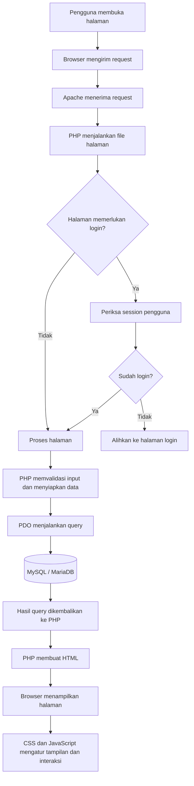
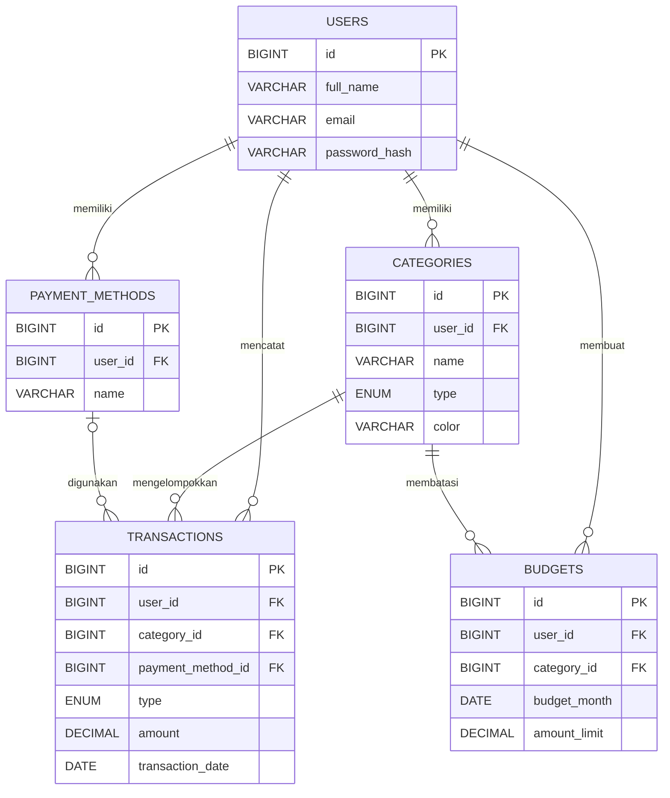
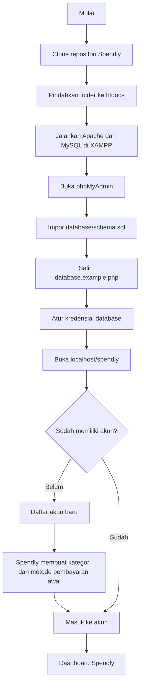
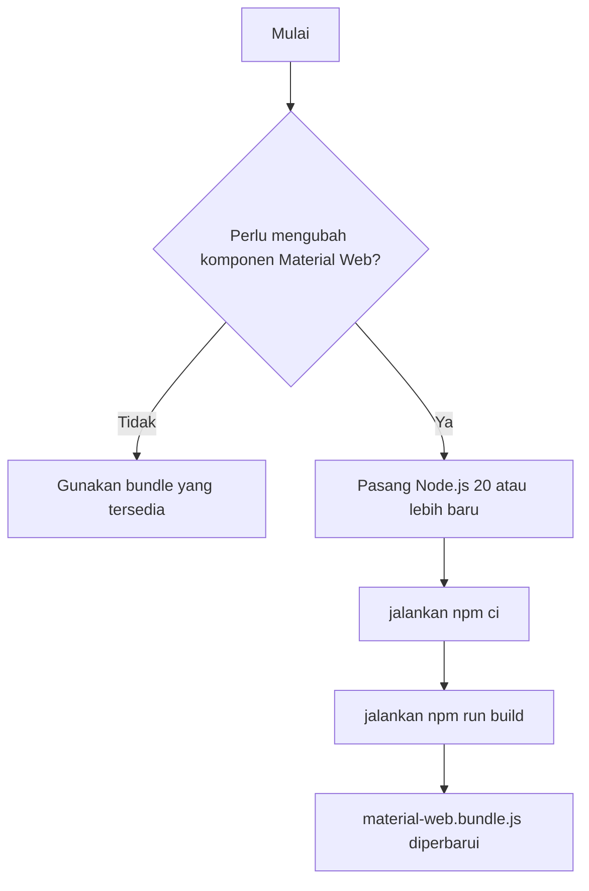

# Panduan Teknis Spendly

Dokumen ini menjelaskan secara singkat apa itu Spendly, teknologi yang digunakan, susunan kode, database, dan cara menjalankannya di komputer lokal.

## 1. Tentang Spendly

Spendly adalah aplikasi web sederhana untuk mengelola keuangan pribadi. Pengguna dapat mencatat pemasukan dan pengeluaran, mengatur anggaran bulanan, serta melihat ringkasan keuangan.

Fitur utama:
- **Dashboard:** menampilkan saldo, pemasukan, pengeluaran, dan transaksi terbaru.
- **Transactions:** mencatat, mengubah, menghapus, dan mencari transaksi.
- **Budgets:** mengatur batas pengeluaran bulanan.
- **Categories:** mengelola kategori pemasukan dan pengeluaran.
- **Payment Methods:** mengelola metode pembayaran.
- **Reports:** melihat ringkasan dan laporan keuangan.

Spendly menggunakan Rupiah (IDR) sebagai mata uang awal. Semua transaksi dimasukkan secara manual oleh pengguna.

## 2. Teknologi

| Teknologi | Kegunaan |
|---|---|
| HTML | Membuat struktur halaman |
| CSS | Mengatur tampilan dan layout |
| JavaScript | Menambahkan interaksi pada halaman |
| PHP 8.x | Menangani proses aplikasi di server |
| MySQL / MariaDB | Menyimpan data aplikasi |
| Apache (XAMPP) | Menjalankan aplikasi di komputer lokal |
| PDO | Menghubungkan PHP dengan database |
| Material Web | Menyediakan beberapa komponen antarmuka |
| Node.js dan npm | Membangun ulang aset Material Web jika diperlukan |

Spendly menggunakan PHP biasa tanpa framework frontend. Halaman dibuat oleh PHP di sisi server, kemudian dikirim ke browser dalam bentuk HTML.

## 3. Cara Kerja Aplikasi

Diagram berikut menunjukkan alur ketika pengguna membuka halaman Spendly:



Secara sederhana, PHP menangani proses aplikasi dan komunikasi database. Browser menampilkan hasilnya.

## 4. Struktur Folder

Folder dan file yang paling penting:

```text
spendly/
├── assets/
│   ├── css/app.css
│   └── js/
│       ├── app.js
│       ├── material-web.entry.js
│       └── material-web.bundle.js
├── config/
│   └── database.example.php
├── database/
│   └── schema.sql
├── includes/
│   ├── auth.php
│   ├── db.php
│   ├── csrf.php
│   ├── functions.php
│   ├── transactions.php
│   ├── budgets.php
│   ├── catalog.php
│   └── reports.php
├── dashboard.php
├── transactions.php
├── budgets.php
├── categories.php
├── payment-methods.php
├── reports.php
├── login.php
├── register.php
└── index.php
```

Keterangan:
- `assets/`: file CSS dan JavaScript.
- `config/`: konfigurasi koneksi database.
- `database/`: struktur tabel database.
- `includes/`: fungsi PHP yang digunakan bersama oleh halaman lain.
- File PHP di folder utama: halaman dan proses utama aplikasi.

## 5. Database

Database Spendly bernama `spendly_db` dan memiliki lima tabel:

| Tabel | Isi |
|---|---|
| `users` | Data akun pengguna |
| `categories` | Kategori pemasukan dan pengeluaran |
| `payment_methods` | Metode pembayaran |
| `transactions` | Catatan pemasukan dan pengeluaran |
| `budgets` | Anggaran bulanan berdasarkan kategori |

Hubungan antar tabel:



Setiap data keuangan terhubung dengan pengguna pemiliknya. Transaksi terhubung dengan kategori dan dapat memiliki metode pembayaran. Anggaran terhubung dengan kategori pengeluaran.

Struktur database tersedia di `database/schema.sql`. File ini digunakan saat membuat database untuk pertama kali.

## 6. Cara Instalasi dan Menjalankan Spendly

### Persiapan

Pastikan XAMPP sudah terpasang dan menyediakan Apache, MySQL, PHP, serta phpMyAdmin.

### Alur instalasi



### Clone repositori

Jalankan perintah berikut:

```bash
git clone https://github.com/mayangzahratusita08/spendly.git
```

Letakkan folder `spendly` di dalam folder `htdocs` XAMPP. Contoh lokasi Windows:

```text
C:\xampp\htdocs\spendly
```

### Jalankan XAMPP

Buka XAMPP Control Panel, kemudian jalankan **Apache** dan **MySQL**.

### Impor database

1. Buka `http://localhost/phpmyadmin/`.
2. Pilih menu **Import**.
3. Pilih file `database/schema.sql` dari folder Spendly.
4. Jalankan proses import.

File schema akan membuat database `spendly_db` beserta tabel-tabel yang diperlukan.

### Atur koneksi database

Salin file `config/database.example.php` menjadi `config/database.php`.

**Windows PowerShell:**

```powershell
Copy-Item config/database.example.php config/database.php
```

**Linux atau macOS:**

```bash
cp config/database.example.php config/database.php
```

Buka `config/database.php`, lalu sesuaikan host, nama database, username, dan password MySQL. Konfigurasi bawaan XAMPP biasanya menggunakan username `root` dan password kosong, tetapi sesuaikan dengan instalasi masing-masing.

**Jangan unggah `config/database.php` ke GitHub**, karena file tersebut berisi kredensial lokal.

### Buka aplikasi

Setelah konfigurasi selesai, buka alamat berikut di browser:

```text
http://localhost/spendly/
```

Pengguna akan diarahkan ke halaman login. Buat akun melalui menu registrasi jika belum memiliki akun.

## 7. Build Aset (Opsional)

Bundle Material Web sudah tersedia di repositori. Karena itu, langkah ini biasanya tidak diperlukan untuk sekadar menjalankan aplikasi.

Alur build aset:



Perintah build:

```bash
npm ci
npm run build
```

Perintah tersebut akan memperbarui file `assets/js/material-web.bundle.js`.

## 8. Catatan Kode dan Keamanan

Beberapa hal penting dalam kode Spendly:

- `includes/db.php` mengatur koneksi database menggunakan PDO.
- `includes/auth.php` mengatur registrasi, login, dan session pengguna.
- `includes/csrf.php` menyediakan fungsi perlindungan CSRF untuk formulir.
- `includes/transactions.php`, `includes/budgets.php`, dan `includes/catalog.php` berisi proses pengelolaan data.
- Query menggunakan prepared statements dan data dibatasi berdasarkan ID pengguna yang sedang login.
- Password disimpan dalam bentuk hash, bukan teks biasa.
- Output pengguna di-escape untuk membantu mencegah XSS.

**Catatan:** handler `logout.php` pada kode saat ini belum memvalidasi token CSRF atau membatasi request hanya melalui POST. Ini merupakan bagian yang masih dapat diperbaiki.

Untuk menjalankan Spendly di server publik, keamanan konfigurasi server dan database perlu diperiksa kembali. Proyek ini terutama disiapkan untuk lingkungan lokal XAMPP.

---

**Dokumentasi teknis Spendly**
