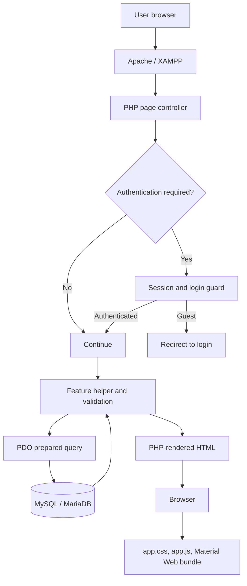
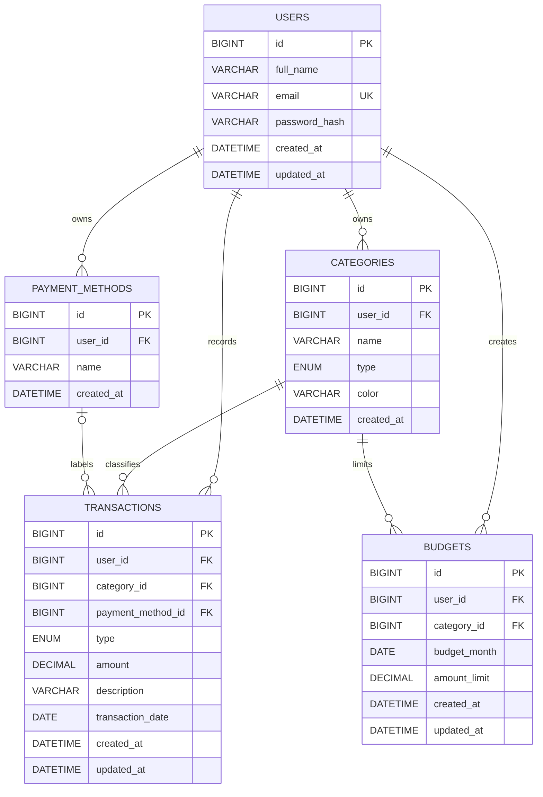

# Spendly Technical Documentation

> **Project:** Spendly — Personal Expense Tracker  
> **Tagline:** *Track your spending. Stay in control.*  
> **Repository:** [mayangzahratusita08/spendly](https://github.com/mayangzahratusita08/spendly)  
> **Documentation basis:** `main` at commit `92faf2c8b513077357a37a3bf874ecc9e04d4f7f`

This document explains the current implementation of Spendly: what the application does, which technologies it uses, how its code and database are organized, how its main features work, and how to install, build, run, and maintain it locally.

The descriptions below are based on files present in the repository. They describe the implemented application, not features that were only proposed or explored on unmerged branches.

---

## 1. Project Overview

Spendly is a browser-based personal finance application for recording income and expenses, organizing transactions, setting monthly spending limits, and reviewing financial activity.

The application is designed for individual accounts. Each registered user has their own transactions, categories, payment methods, and budgets. The initial display currency is Indonesian Rupiah (IDR), and the application interface is written in English.

### 1.1 Main objectives

- Record personal income and expenses.
- Organize financial records by category and payment method.
- Review and filter transaction history.
- Set monthly budgets for expense categories.
- Compare actual spending with budget limits.
- Review monthly financial summaries and six-month trends.

### 1.2 Main features

| Area | What it does |
|---|---|
| Authentication | Register, sign in, maintain a session, and sign out |
| Dashboard | Display current balance, current-month income and expenses, monthly budgets, and recent transactions |
| Transactions | Create, view, edit, delete, and filter income or expense records |
| Budgets | Create and manage category budgets for a selected calendar month |
| Categories | Manage income and expense categories, including their display colors |
| Payment methods | Manage labels such as Cash, Bank Transfer, and E-Wallet |
| Reports | Review monthly totals, six-month trends, category breakdowns, payment-method spending, and budget performance |

### 1.3 Scope and boundaries

Spendly is a manual personal expense tracker. Users enter transactions themselves.

The current implementation does not provide bank-account synchronization, automatic bank transaction imports, payment processing, multi-currency conversion, a business accounting workflow, or PDF/Excel report export. It is built and documented primarily for local development with XAMPP; a public production deployment needs additional operational and security review.

---

## 2. Technology Stack

### 2.1 Application stack

| Technology | Role in Spendly |
|---|---|
| HTML5 | Semantic page structure and forms |
| CSS3 | Layout, responsive styling, Material 3-inspired design tokens, and component styling |
| JavaScript (vanilla) | Small browser interactions such as the mobile drawer, alert dismissal, password confirmation, and transaction-category filtering |
| PHP 8.x | Server-side page rendering, request handling, validation, authentication, and application logic |
| PDO MySQL | Database connection and prepared SQL statements |
| MySQL 8.0+ / MariaDB 10.4+ | Relational data storage |
| Apache (XAMPP) | Local web server |
| Material Web 2.5.0 | Selectively used Material 3 web components |
| esbuild 0.28.2 | Bundles the Material Web imports for the browser |
| Node.js 20+ | Required when rebuilding the frontend bundle |

PHP and MySQL are required to run the application. Node.js and npm are used for the frontend asset build. They are not a replacement for Apache, PHP, or MySQL.

### 2.2 Frontend component bundle

The repository contains a selective Material Web entry point at `assets/js/material-web.entry.js`. It imports the components currently used by the application:

- Filled, outlined, and text buttons.
- Outlined text fields.
- Outlined select and select-option components.
- Linear progress.

The build configuration is in `package.json`. The generated browser bundle is committed at `assets/js/material-web.bundle.js` and loaded by the shared PHP header.

Spendly uses Material Web selectively. Other screens also use semantic HTML controls styled through the shared stylesheet. The application is not a single-page application and does not use a JavaScript frontend framework.

---

## 3. Application Architecture

### 3.1 Architectural style

Spendly uses a **server-rendered, multi-page PHP architecture**.

Each page is a PHP entry point. A page checks authentication, reads request parameters, calls shared helper functions and PDO queries, then renders HTML using PHP templates. The browser receives the completed HTML together with shared CSS and JavaScript assets.

There is no separate REST API layer in the current application.

### 3.2 Request and rendering flow



### 3.3 Responsibilities by layer

1. **Page controllers (root-level PHP files)**  
   Receive GET or POST requests, enforce page access, validate request data, call helper functions, prepare page variables, and include the shared layout.

2. **Shared helpers (`includes/`)**  
   Provide authentication, sessions, CSRF protection, database connection, formatting, validation, and data-access functions shared by multiple pages.

3. **Database (`database/schema.sql`)**  
   Defines the relational tables, foreign keys, indexes, data types, and uniqueness constraints.

4. **Presentation layer (`includes/header.php`, `includes/footer.php`, and page markup)**  
   Provides the shared sidebar or guest header, flash messages, page content, and footer.

5. **Browser assets (`assets/`)**  
   Provide the design system, responsive styling, client-side enhancements, and bundled Material Web custom elements.

### 3.4 Typical request lifecycle

A protected page normally follows this sequence:

1. Load the required shared PHP files with `require_once`.
2. Call `require_login()`.
3. Read the signed-in user through `current_user()` and obtain the user's ID.
4. Get the shared PDO instance through `get_db_connection()`.
5. Read and validate GET parameters or POST form data.
6. For a state-changing form, verify the submitted CSRF token.
7. Call a feature helper or execute a prepared query scoped to the current user.
8. Set `$pageTitle` and `$activeNav`.
9. Include `includes/header.php`, render the page, and include `includes/footer.php`.

After a successful form submission, controllers generally use a redirect and a flash message rather than rendering the success response directly.

---

## 4. Repository Structure

The following is the application structure on the documented `main` branch. Generated or local-only files are noted separately.

```text
spendly/
├── assets/
│   ├── css/
│   │   └── app.css
│   └── js/
│       ├── app.js
│       ├── material-web.entry.js
│       └── material-web.bundle.js
├── config/
│   └── database.example.php
├── database/
│   └── schema.sql
├── includes/
│   ├── auth.php
│   ├── budgets.php
│   ├── catalog.php
│   ├── csrf.php
│   ├── db.php
│   ├── footer.php
│   ├── functions.php
│   ├── header.php
│   ├── reports.php
│   └── transactions.php
├── budget-create.php
├── budget-delete.php
├── budget-edit.php
├── budgets.php
├── categories.php
├── category-create.php
├── category-delete.php
├── category-edit.php
├── dashboard.php
├── index.php
├── login.php
├── logout.php
├── payment-method-create.php
├── payment-method-delete.php
├── payment-method-edit.php
├── payment-methods.php
├── register.php
├── reports.php
├── transaction-create.php
├── transaction-delete.php
├── transaction-edit.php
├── transactions.php
├── design-system.md
├── package.json
├── package-lock.json
├── README.md
└── .gitignore
```

### 4.1 Important directories

| Path | Responsibility |
|---|---|
| `assets/css/` | Shared stylesheet and design-system implementation |
| `assets/js/` | Browser behavior and Material Web build entry/output |
| `config/` | Database configuration template; local credentials are not committed |
| `database/` | MySQL schema |
| `includes/` | Reusable PHP infrastructure and feature helpers |

### 4.2 Shared PHP files

| File | Responsibility |
|---|---|
| `includes/db.php` | Creates and reuses the PDO MySQL connection |
| `includes/auth.php` | Registration, login, logout, session guards, and default user-data seeding |
| `includes/csrf.php` | Generates, renders, and verifies CSRF tokens |
| `includes/functions.php` | Session initialization, HTML escaping, currency/date formatting, redirects, flash messages, and base URLs |
| `includes/transactions.php` | Transaction queries, validation, and CRUD operations |
| `includes/budgets.php` | Budget validation, CRUD operations, and monthly spending calculations |
| `includes/catalog.php` | Category and payment-method management |
| `includes/reports.php` | Read-only analytics queries |
| `includes/header.php` | Shared authenticated sidebar, guest header, flash messages, and asset loading |
| `includes/footer.php` | Shared footer and application JavaScript inclusion |

---

## 5. Database Design

### 5.1 Database overview

The schema creates a database named `spendly_db` using the InnoDB storage engine and `utf8mb4_unicode_ci` collation.

There are five tables:

1. `users`
2. `categories`
3. `payment_methods`
4. `transactions`
5. `budgets`

### 5.2 Entity relationships



### 5.3 Table responsibilities and rules

**`users`**

Stores account identity and password hashes. Email is unique. Passwords are not stored as plain text.

**`categories`**

Stores user-owned categories. The `type` column is either `income` or `expense`. A category has a user-defined name and optional display color. The combination of user, name, and type is unique.

**`payment_methods`**

Stores user-owned labels such as Cash, Bank Transfer, E-Wallet, or Debit / Credit Card. A method name is unique per user.

**`transactions`**

Stores the actual financial records. The `type` column is either `income` or `expense`. The amount uses `DECIMAL(14,2)`; the transaction date uses `DATE`; the description is optional; and the payment method may be `NULL`. A category is required.

**`budgets`**

Stores a spending limit for an expense category and calendar month. The application stores the first day of the month in `budget_month`, for example `2026-11-01`. A user can have only one budget for the same category and month.

### 5.4 Important constraints

| Constraint | Effect |
|---|---|
| Unique user email | Prevents two accounts from using the same email |
| Unique category per user/name/type | Prevents duplicate category labels of the same type for one user |
| Unique payment method per user/name | Prevents duplicate payment method labels for one user |
| Unique budget per user/category/month | Prevents duplicate monthly limits for the same category |
| User foreign keys with cascade | User-owned records are removed when the owning user is removed |
| Transaction category/payment foreign keys with restrict | Referenced categories and payment methods cannot be deleted while transactions use them |
| Budget category foreign key with restrict | A category referenced by a budget cannot be deleted |

The application also checks ownership in its PHP validation and query logic. The schema uses individual foreign keys for these references; the application-level `user_id` checks are therefore important and must not be removed.

### 5.5 Schema installation and changes

The canonical schema is `database/schema.sql`. It contains `CREATE DATABASE IF NOT EXISTS`, `USE spendly_db`, and table definitions using `CREATE TABLE IF NOT EXISTS`.

There is no separate migration framework in the current repository. For a new local installation, import the schema. If changing the schema later, update `database/schema.sql`, preserve existing data where necessary, and document the change rather than assuming that re-importing the file will migrate an existing database.

---

## 6. Feature Implementation

### 6.1 Application entry and authentication

| Page | Responsibility |
|---|---|
| `index.php` | Redirects signed-in users to the dashboard and guests to login |
| `register.php` | Displays and processes account registration |
| `login.php` | Displays and processes sign-in |
| `logout.php` | Ends the current session and redirects to sign-in |

Registration validates the user's name, email, password length, and password confirmation. The password is hashed with PHP's `password_hash()` using `PASSWORD_DEFAULT`.

After inserting a user, registration starts a database transaction and seeds the user's initial categories and payment methods. The seed operation includes:

- **Income categories:** Salary, Freelance, Gift, Other Income.
- **Expense categories:** Food, Transportation, Shopping, Bills, Education, Health, Entertainment, Other Expense.
- **Payment methods:** Cash, Bank Transfer, E-Wallet, Debit / Credit Card.

If registration and seeding succeed, the transaction is committed. If an exception occurs, it is rolled back.

Login retrieves the account by email and verifies the password with `password_verify()`. On successful login, the session ID is regenerated and the user's ID and basic profile information are stored in the session.

### 6.2 Transactions

Relevant files:

- `transactions.php`
- `transaction-create.php`
- `transaction-edit.php`
- `transaction-delete.php`
- `includes/transactions.php`

A transaction records:

- Type: income or expense.
- Positive amount.
- Category matching the selected transaction type.
- Optional payment method.
- Transaction date.
- Optional description or note.

The transaction list supports filtering by type, category, start date, and end date. Filters are submitted through GET parameters, so a filtered list can be refreshed or bookmarked.

The create/edit helper validates the amount, date, category ownership, category type, optional payment-method ownership, and description length on the server. CRUD operations use the authenticated user's ID to scope records.

### 6.3 Budgets

Relevant files:

- `budgets.php`
- `budget-create.php`
- `budget-edit.php`
- `budget-delete.php`
- `includes/budgets.php`

A budget belongs to one expense category and one month. Its spending total is calculated from expense transactions in that category whose transaction dates fall inside the selected calendar month.

The page displays the budget limit, actual spending, remaining amount or overage, and progress percentage. The status rules are:

| Status | Condition |
|---|---|
| On track | Spending is below 80% of the limit |
| Near limit | Spending is at least 80% and has not exceeded the limit |
| Over budget | Spending is greater than the limit |

Income transactions are not counted as budget spending.

### 6.4 Categories

Relevant files:

- `categories.php`
- `category-create.php`
- `category-edit.php`
- `category-delete.php`
- `includes/catalog.php`

Categories are separated into Income and Expense groups. Users can create categories and update their names or colors.

A category's type cannot be changed while transactions or budgets reference it. A category cannot be deleted while it is referenced by a transaction or budget. This protects existing financial history.

### 6.5 Payment methods

Relevant files:

- `payment-methods.php`
- `payment-method-create.php`
- `payment-method-edit.php`
- `payment-method-delete.php`
- `includes/catalog.php`

Users can add, rename, and remove their payment-method labels. A method referenced by a transaction is protected from deletion. Renaming a method does not remove or rewrite the transaction records that reference its ID.

### 6.6 Dashboard

File: `dashboard.php`

The dashboard queries live records for the authenticated user and displays:

- **Current balance:** all-time income minus all-time expenses.
- **Monthly income:** income transactions dated in the current calendar month.
- **Monthly expenses:** expense transactions dated in the current calendar month.
- **Monthly budget overview:** budget limits and actual spending for the current month.
- **Recent transactions:** the five most recent records.
- **Categories and payment methods:** a compact overview of the user's configured labels.

The figures are calculated from database records. The application does not insert decorative sample balances or fake transactions into the dashboard.

### 6.7 Analytics and reports

Files: `reports.php` and `includes/reports.php`.

The report page accepts a selected month and calculates:

- Total income and total expenses for that month.
- Net cash flow: income minus expenses.
- Savings rate: `(income - expenses) / income × 100`, when income is greater than zero.
- A six-month income-versus-expense trend ending in the selected month.
- Expense totals grouped by category.
- Income totals grouped by category.
- Expense totals grouped by payment method.
- Budget performance for categories with a budget in the selected month.

Transactions without a payment method are included under `Unspecified`. Budget performance only includes categories with a configured budget; unbudgeted expenses are intentionally excluded from the tracked-budget comparison.

The chart is rendered from server-provided values using HTML and CSS. A separate charting library is not part of the current stack.

---

## 7. Shared Layout and Design System

### 7.1 Shared application shell

The shared layout is implemented in `includes/header.php` and `includes/footer.php`.

- Signed-in pages use a persistent desktop sidebar.
- The sidebar groups links into Overview and Manage sections.
- The sidebar shows the current account and a sign-out action.
- On smaller screens, the sidebar becomes a drawer opened from the mobile app bar.
- Guest pages use a compact header with sign-in and account-creation links.
- Flash messages are rendered by the shared header.

The mobile drawer supports a backdrop, Escape-to-close behavior, keyboard focus handling, and body scroll locking while open.

### 7.2 Material 3 implementation

The design system is documented in `design-system.md`. The current implementation is Material 3-inspired and uses a forest-green brand palette, semantic surface and text roles, a consistent shape scale, and responsive layouts.

Material Web components are used selectively where present in the PHP pages. Most pages also use semantic HTML and shared CSS. The current application should not be described as a full Material 3 Expressive implementation; experimental work on that direction is separate from the merged main-branch implementation.

### 7.3 Browser-side JavaScript

File: `assets/js/app.js`.

The shared script handles:

1. Mobile sidebar open/close interactions.
2. Closing flash alerts.
3. Client-side password-confirmation feedback on registration.
4. Filtering the category dropdown when the transaction type changes.

These browser-side checks improve usability. Server-side validation remains authoritative.

---

## 8. Security and Data Integrity

The current code implements several security controls. They should be preserved when adding or changing features.

| Control | Implementation |
|---|---|
| Password storage | `password_hash()` with `PASSWORD_DEFAULT` |
| Password verification | `password_verify()` |
| Session cookies | HttpOnly and SameSite=Lax; Secure is enabled when the request uses HTTPS |
| Session fixation defense | Session ID regenerated after successful login |
| Authentication guards | `require_login()` and `require_guest()` |
| CSRF helpers | Token generated using `random_bytes()` and compared using `hash_equals()` |
| SQL injection mitigation | PDO prepared statements; emulated prepares disabled |
| XSS mitigation | `e()` helper escapes HTML output with `htmlspecialchars()` |
| User data isolation | Queries and mutations use the authenticated user's ID |
| Reference integrity | Foreign keys restrict deletion of referenced categories, payment methods, and budget categories |
| Local secrets | `config/database.php` is excluded through `.gitignore` |

### 8.1 Important implementation note: logout

The sidebar submits logout through a POST form that includes a CSRF field. However, the current `logout.php` handler calls `logout_user()` unconditionally: it does not reject non-POST requests and does not enforce the submitted CSRF token. This is the behavior of the current source code, not a claim that logout has complete CSRF enforcement.

For a future security-hardening pass, make logout POST-only and reject requests with an invalid CSRF token.

### 8.2 Local credentials

The repository contains `config/database.example.php`. Copy it to `config/database.php` for local use and update the credentials as required.

Never commit `config/database.php`, production credentials, database dumps containing personal records, or other secrets. The local configuration file is already listed in `.gitignore`.

### 8.3 Production considerations

The application is set up for local XAMPP development. Before deploying it publicly, review HTTPS enforcement, database credentials and privileges, logout CSRF handling, account recovery, brute-force/rate limiting, backups, error logging, and server configuration. Do not use the default local XAMPP root credentials on a public server.

---

## 9. Installation and Local Setup with XAMPP

### 9.1 Prerequisites

Install:

- XAMPP with Apache, MySQL/MariaDB, PHP, and phpMyAdmin.
- PHP 8.x with PDO MySQL support.
- Node.js 20 or newer and npm, if rebuilding the Material Web bundle.
- Git, if cloning the repository.

The repository README recommends MySQL 8.0+ or MariaDB 10.4+.

### 9.2 Clone the repository

Open a terminal:

```bash
git clone https://github.com/mayangzahratusita08/spendly.git
```

Move or clone the project into the XAMPP web root.

Common locations:

| Operating system | Web root |
|---|---|
| Windows | `C:\\xampp\\htdocs\\spendly` |
| macOS | `/Applications/XAMPP/xamppfiles/htdocs/spendly` |
| Linux | `/opt/lampp/htdocs/spendly` |

The final folder should contain `index.php`, `dashboard.php`, `database/`, `includes/`, and the other project files.

### 9.3 Start Apache and MySQL

1. Open the XAMPP Control Panel.
2. Start **Apache**.
3. Start **MySQL**.
4. Confirm that both services report as running.

If Apache or MySQL cannot start, check whether another process is already using the configured port.

### 9.4 Create the database and import the schema

1. Open phpMyAdmin at `http://localhost/phpmyadmin/`.
2. The schema file is `database/schema.sql`.
3. The file creates `spendly_db` if it does not already exist, selects that database, and creates the five tables.
4. You can import the file through phpMyAdmin's **Import** tab. If you prefer to create the database first, use the name `spendly_db` and an `utf8mb4` collation, then import the schema into it.
5. Confirm that these five tables exist: `users`, `categories`, `payment_methods`, `transactions`, and `budgets`.

### 9.5 Configure the database connection

Create the local configuration file by copying the template.

**Windows PowerShell:**

```powershell
Copy-Item config/database.example.php config/database.php
```

**macOS / Linux:**

```bash
cp config/database.example.php config/database.php
```

Open `config/database.php` and set values for your local MySQL server. The committed example uses:

```php
return [
    'host'     => '127.0.0.1',
    'port'     => 3306,
    'dbname'   => 'spendly_db',
    'username' => 'root',
    'password' => '',
    'charset'  => 'utf8mb4',
];
```

The empty password is a common default in local XAMPP installations, not a recommended public-server configuration. Change it if your MySQL root account uses a password.

### 9.6 Build the Material Web assets

The generated bundle is committed to the repository. To reproduce the frontend build locally or rebuild it after changing the Material Web entry point:

```bash
npm ci
npm run build
```

This uses the versions pinned in `package-lock.json` and writes the bundle to `assets/js/material-web.bundle.js`.

Use Node.js 20 or newer. When changing component imports, edit `assets/js/material-web.entry.js` and run the build again.

### 9.7 Open Spendly

Open:

```text
http://localhost/spendly/
```

The `index.php` entry point redirects:

- Signed-in users to `dashboard.php`.
- Guests to `login.php`.

Select **Create an account**, register with a name, email, and password of at least eight characters, then sign in. Registration automatically creates the default categories and payment methods for that user. A new account initially has no transactions, so financial totals are zero and transaction areas show empty states.

---

## 10. Running and Using the Application

After installation, the main pages are:

| Page | URL path | Purpose |
|---|---|---|
| Entry | `/` | Redirect to Dashboard or Sign In |
| Sign in | `/login.php` | Authenticate an existing user |
| Register | `/register.php` | Create an account |
| Dashboard | `/dashboard.php` | Review financial summary and recent activity |
| Transactions | `/transactions.php` | Browse and filter records |
| Add transaction | `/transaction-create.php` | Record income or expense |
| Edit transaction | `/transaction-edit.php?id={id}` | Update an owned transaction |
| Budgets | `/budgets.php` | Review monthly category limits |
| Categories | `/categories.php` | Manage income and expense categories |
| Payment methods | `/payment-methods.php` | Manage payment labels |
| Reports | `/reports.php` | Review monthly analytics |

All finance-management pages require an authenticated session.

### Suggested first-use sequence

1. Register and sign in.
2. Review the default categories and payment methods.
3. Add an income transaction.
4. Add an expense transaction.
5. Set a budget for an expense category.
6. Review the dashboard and budget progress.
7. Open Reports and select the month containing the transactions.

---

## 11. Frontend Build and Asset Maintenance

The frontend build configuration is deliberately small.

**Files involved:**

- `package.json`: build scripts and pinned dependency versions.
- `package-lock.json`: resolved dependency tree.
- `assets/js/material-web.entry.js`: explicit list of Material Web component imports.
- `assets/js/material-web.bundle.js`: generated browser bundle.
- `assets/js/app.js`: Spendly's own browser interaction code.
- `assets/css/app.css`: application and component styling.

Run `npm ci` after a clean checkout when you need the build dependencies, then run `npm run build`. Rebuild whenever the Material Web entry imports or dependency versions change.

Do not edit the generated bundle manually. Change the entry point or build source and regenerate it instead.

---

## 12. Development Guidelines

Use these conventions when maintaining or extending Spendly.

### 12.1 Protected pages

- Load the shared authentication helper.
- Call `require_login()` before accessing private data.
- Read the current user through `current_user()`.
- Use the session's user ID for data-access functions and SQL conditions.

### 12.2 Database access

- Reuse `get_db_connection()`.
- Use PDO prepared statements for values supplied by a request.
- Do not concatenate untrusted input into SQL.
- Keep queries scoped to the authenticated user.
- Validate that referenced categories and payment methods belong to that user.

### 12.3 Form handling

- Use POST for state-changing operations.
- Include `csrf_field()` in forms.
- Verify the submitted token using `verify_csrf_token()`.
- Validate every field on the server, even when JavaScript or HTML attributes provide client-side validation.
- Redirect after successful writes and use flash messages for feedback.

### 12.4 Output and presentation

- Escape user-controlled values with `e()` when rendering HTML.
- Reuse the shared header and footer.
- Set `$pageTitle` and `$activeNav` before including the header.
- Keep shared visual tokens and responsive styles in `assets/css/app.css`.
- Keep browser interactions in `assets/js/app.js`.
- Add Material Web imports selectively to `assets/js/material-web.entry.js`, then rebuild the bundle.

### 12.5 Database changes

- Update `database/schema.sql` when the schema changes.
- Explain whether the change is safe for existing data.
- Include a migration or explicit upgrade procedure for an existing installation; do not assume that re-importing a `CREATE TABLE IF NOT EXISTS` schema alters existing tables.
- Preserve foreign-key integrity and unique constraints.

### 12.6 Git workflow

A practical workflow is:

1. Start from an updated `main`.
2. Create a focused branch for one change.
3. Keep changes limited to the relevant feature.
4. Test the affected PHP pages, form submissions, and responsive layout.
5. Review the diff for accidental secrets or unrelated changes.
6. Open a pull request and describe the change and verification performed.

---

## 13. Verification Checklist

Use this checklist after installing the application or making a significant change.

### Environment
- [ ] Apache starts in XAMPP.
- [ ] MySQL starts in XAMPP.
- [ ] `spendly_db` exists and contains all five tables.
- [ ] `config/database.php` exists locally and is not tracked by Git.
- [ ] The application opens at `http://localhost/spendly/`.

### Authentication
- [ ] A new account can be registered.
- [ ] The user's password is stored as a hash.
- [ ] Incorrect credentials are rejected.
- [ ] A guest cannot access protected pages.
- [ ] Sign out returns the user to the sign-in page.

### Financial features
- [ ] Income and expense transactions can be created.
- [ ] Existing transactions can be edited and deleted.
- [ ] Filters return the expected transactions.
- [ ] Budget spending reflects matching expense transactions in the selected month.
- [ ] Referenced categories and payment methods are protected from deletion.
- [ ] Dashboard totals and report totals match the stored transactions.

### Interface
- [ ] Desktop sidebar navigation works.
- [ ] Mobile drawer opens and closes.
- [ ] Forms and Material Web controls render.
- [ ] Tables and report sections remain usable on a narrow viewport.
- [ ] Empty states render when no records exist.

### Build and syntax
- [ ] `npm ci` completes when rebuilding assets.
- [ ] `npm run build` completes successfully.
- [ ] PHP files pass the PHP CLI syntax check.

For example, on Windows with XAMPP installed at `C:\\xampp`:

```powershell
Get-ChildItem -Recurse -Filter *.php |
ForEach-Object {
    & "C:\\xampp\\php\\php.exe" -l $_.FullName
}
```

A successful PHP lint reports `No syntax errors detected` for each file. Syntax checks do not replace browser and database integration tests.

---

## 14. Troubleshooting

| Symptom | What to check |
|---|---|
| Spendly shows a database configuration message | Confirm that `config/database.php` was copied from `config/database.example.php` |
| Database connection error | Confirm MySQL is running, `spendly_db` exists, the port is correct, and the credentials match |
| `could not find driver` | Confirm the PHP `pdo_mysql` extension is enabled in the PHP installation used by Apache |
| phpMyAdmin cannot import the schema | Confirm the SQL file is selected and the MySQL account can create/use the database |
| Apache does not start | Check whether another application is using the Apache ports |
| MySQL does not start | Check for another MySQL service or a port conflict |
| Material Web elements appear as unknown HTML elements | Confirm `assets/js/material-web.bundle.js` exists and the build completed |
| Old styling remains after a change | Refresh the page and confirm that the CSS asset path and file are being served from the current project directory |
| Login redirects repeatedly | Confirm PHP sessions are enabled and the browser accepts session cookies |

---

## 15. Current Implementation Notes

These notes prevent the documentation from being mistaken for a promise of functionality that is not present in the repository:

- Spendly is a server-rendered PHP application, not a SPA.
- There is no separate REST API service.
- Transactions are entered manually; no bank or payment-provider integration is configured.
- IDR is the initial display currency. Currency conversion is not implemented.
- Reports are calculated from saved database records and rendered in the PHP page.
- The Material Web bundle is built locally from pinned npm dependencies.
- The repository does not define a PHP unit-test command in `package.json`; the npm scripts build frontend assets.
- The current logout handler clears the session but does not enforce POST-only plus CSRF validation; see Section 8.1.
- Local XAMPP setup is documented. A public deployment requires additional security and operational hardening.

---

## 16. Reference Files

For source-level details, use these repository files as the implementation references:

| Topic | Source files |
|---|---|
| Database schema | `database/schema.sql` |
| Local database settings | `config/database.example.php`, `includes/db.php` |
| Authentication and registration seeding | `includes/auth.php`, `login.php`, `register.php`, `logout.php` |
| Sessions and shared helpers | `includes/functions.php` |
| CSRF | `includes/csrf.php` |
| Transactions | `includes/transactions.php`, transaction page controllers |
| Budgets | `includes/budgets.php`, budget page controllers |
| Categories and payment methods | `includes/catalog.php`, category and payment-method page controllers |
| Reports | `includes/reports.php`, `reports.php` |
| Shared layout | `includes/header.php`, `includes/footer.php` |
| Browser behavior | `assets/js/app.js` |
| Material Web build | `package.json`, `package-lock.json`, `assets/js/material-web.entry.js` |
| Styling and design tokens | `assets/css/app.css`, `design-system.md` |
| Project summary and quick setup | `README.md` |

---

**End of Spendly Technical Documentation**
